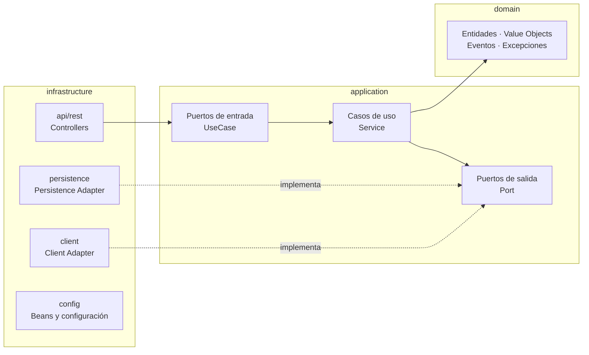

# Arquitectura

Referencia técnica del servicio. Define **cómo** se estructura y escribe el código. Las reglas de negocio están en `business-rules.md`.

## 1. Visión general

El servicio sigue **Clean Architecture** y **DDD táctico**. El dominio está en el centro y no depende de ningún framework; todo lo técnico (HTTP, base de datos, clientes externos) vive en `infrastructure` y se conecta con el núcleo mediante puertos.



## 2. Estructura de módulos

```
contract-api/
├── domain/            # Núcleo del negocio. Java puro, SIN dependencias de frameworks.
├── application/       # Casos de uso y puertos. Depende solo de domain.
└── infrastructure/    # Adaptadores de entrada (API REST) y salida (JPA, clientes),
                       # configuración de Spring y clase main.
```

### Paquetes

Paquete base: **`pe.edu.galaxy.training.ia.ca`**

| Módulo | Paquete raíz |
|---|---|
| `domain` | `pe.edu.galaxy.training.ia.ca.domain` |
| `application` | `pe.edu.galaxy.training.ia.ca.application` |
| `infrastructure` | `pe.edu.galaxy.training.ia.ca.infrastructure` |

### Detalle por capa

Rutas relativas al paquete raíz de cada módulo.

```
domain/
  common/                 # Bloques genéricos DDD, sin conceptos de negocio
    model/                # AggregateRoot, Entity, Identifier
    event/                # DomainEvent (interfaz abierta)
    exception/            # DomainException, InvalidValueException (VAL-001), Guard
  shared/                 # Shared kernel: conceptos de negocio transversales
    vo/                   # Money
  <agregado>/             # Un paquete por agregado: contract, employee
    model/                # Raíz del agregado (Contract, Employee)
    vo/                   # Value objects e identificador del agregado; los enums también van aquí
    event/                # Interfaz sealed del agregado (p. ej. ContractEvent) y sus eventos
    exception/            # Excepciones del agregado (extienden DomainException)

application/
  port/in/        # Interfaces de casos de uso (p. ej. CreateContractUseCase)
  port/out/       # Interfaces hacia el exterior (p. ej. ContractRepositoryPort)
  usecase/        # Implementaciones de casos de uso (p. ej. CreateContractService)
  dto/            # Commands, Queries y Results (records inmutables)
  exception/      # Excepciones de aplicación (NotFoundException, ConflictException y subclases)

infrastructure/
  ContractApiApplication.java  # Clase main de Spring Boot
  persistence/            # Adaptadores que implementan los puertos de salida (p. ej. ContractPersistenceAdapter)
    adapter/
    entity/               # Entidades JPA (<Entidad>JpaEntity)
    repository/           # Repositorios Spring Data
    mapper/               # Mappers dominio ↔ entidad JPA
  api/
    dto/                  # Request y Response de la API
    rest/                 # Controllers y mappers Request/Response ↔ Command/Result
    rest/error/           # @RestControllerAdvice y traducción a Problem Details
  client/                 # Adaptadores de servicios externos (<Sistema>RestClientAdapter)
  security/               # Spring Security (ADR-0005); adaptadores de puertos de identidad
    authn/                # Autenticación de credenciales (CredentialsAuthenticatorAdapter)
    config/               # Cadenas de filtros y propiedades de seguridad
    crypto/               # Hash de contraseñas y de refresh tokens (PasswordHasherAdapter)
    handler/              # Errores 401/403 como Problem Details
    jwt/                  # Emisión y validación de JWT (TokenIssuerAdapter)
  config/                 # @Configuration: registro de casos de uso como beans, propiedades, etc.
```

### Dependencias dentro de `domain` (ADR-0004)

- `common` y `shared` no importan de ningún agregado; `common` tampoco importa de `shared`.
- Un agregado no importa de otro salvo su identificador (`contract` usa `EmployeeId`, nunca `Employee`).
- Un concepto pasa a `shared` solo si lo usan dos o más agregados o es transversal (como `Money`).
- Los métodos del agregado que emiten eventos reciben un `java.time.Clock`; el dominio no llama a `now()`.
- Los value objects lanzan excepciones de dominio, nunca `NullPointerException` ni `IllegalArgumentException`
  (se usa `Guard.notNull`, que lanza `InvalidValueException`).

## 3. Reglas de arquitectura (obligatorias)

1. **Regla de dependencia:** `infrastructure` → `application` → `domain`. El dominio no depende de nada; `application` no conoce `infrastructure`.
2. **`domain` es Java puro:** prohibido importar `org.springframework.*`, `jakarta.persistence.*`, Lombok o Jackson.
3. **`application` no conoce frameworks** salvo, como máximo, `@Transactional`. Los casos de uso se registran como beans en `infrastructure/config`, no con `@Service`.
4. **Nunca exponer entidades** de dominio ni JPA en la API: siempre DTOs de `api/dto`.
5. **Entidad de dominio ≠ entidad JPA.** Se convierten con los mappers de `persistence/mapper`.
6. **Un caso de uso = una clase = una operación de negocio.** Nada de "servicios dios".
7. **Los puertos de salida los define `application`** y los implementa `infrastructure` (`persistence`, `client`).
8. **Las invariantes de negocio viven en el dominio**, no en controllers ni en validaciones de Bean Validation.
9. **Aislamiento dentro de `infrastructure`:** `api` solo invoca puertos de entrada (`port.in`); nunca usa `persistence`, `client` ni `security` directamente. `persistence`, `client` y `security` no dependen de `api`.

> Estas reglas se verifican en la revisión de código (ver `prompts/prompts.md`, sección 5). No hay verificación automática con ArchUnit (ADR-0003).

## 4. Flujo de una petición

1. El **controller** (`infrastructure/api/rest`) recibe el `Request`, valida el formato (Bean Validation) y lo mapea a un `Command`/`Query`.
2. Invoca el **puerto de entrada** (`XxxUseCase`).
3. El **caso de uso** orquesta: carga agregados vía puertos de salida, delega la lógica al **dominio** y persiste el resultado.
4. El caso de uso devuelve un `Result`; el controller lo mapea a `Response`.
5. Cualquier excepción la traduce `api/rest/error` a Problem Details.

## 5. Convenciones de código

### Nombres

| Elemento | Patrón | Ejemplo |
|---|---|---|
| Puerto de entrada | `<Verbo><Entidad>UseCase` | `CreateContractUseCase` |
| Caso de uso | `<Verbo><Entidad>Service` | `CreateContractService` |
| Puerto de salida | `<Entidad>RepositoryPort`, `<Sistema>ClientPort` | `ContractRepositoryPort` |
| Adaptador | `<Entidad>PersistenceAdapter`, `<Sistema>RestClientAdapter` | `ContractPersistenceAdapter` |
| DTO de aplicación | `<Verbo><Entidad>Command`, `<Entidad>Query`, `<Entidad>Result` | `CreateContractCommand` |
| DTO REST | `<Entidad>Request`, `<Entidad>Response` | `ContractResponse` |
| Entidad JPA | `<Entidad>JpaEntity` | `ContractJpaEntity` |
| Repositorio Spring Data | `<Entidad>JpaRepository` | `ContractJpaRepository` |
| Controller | `<Entidad>Controller` | `ContractController` |

### Reglas de estilo

- **Inmutabilidad:** preferir `record` para DTOs y value objects. Las entidades exponen comportamiento, no setters.
- **Value objects** para conceptos con reglas (`ContractId`, `DocumentNumber`, `Money`, `ContractPeriod`); validar en el constructor.
- **Inyección por constructor** siempre. Prohibido `@Autowired` en campos.
- **`Optional`** solo como tipo de retorno, nunca como parámetro ni campo.
- **Sin `null`** en el dominio: usar `Optional`, objetos vacíos o excepciones de dominio.
- Métodos cortos y con un solo nivel de abstracción. Sin comentarios que repitan el código.

## 6. Diseño de la API REST

- Versionado por URL: `/api/v1/...`.
- Recursos en plural y kebab-case: `/api/v1/contracts/{id}`, `/api/v1/employees/{id}/contracts`.
- Paginación: `?page=0&size=20&sort=createdAt,desc`.
- Cada endpoint documentado con anotaciones de OpenAPI.

| Situación | Código |
|---|---|
| Recurso creado | `201` + cabecera `Location` |
| Operación sin contenido de respuesta | `204` |
| Error de formato / validación de entrada | `400` |
| No autenticado / sin permisos (cuando se incorpore seguridad, ADR-0001) | `401` / `403` |
| Recurso no encontrado | `404` |
| Conflicto de estado o concurrencia | `409` |
| Regla de dominio violada | `422` |

## 7. Manejo de errores

- El dominio lanza excepciones de negocio (`DomainException` y subclases); nunca excepciones HTTP.
- `application` puede lanzar `NotFoundException`, `ConflictException`, etc.
- Solo `infrastructure/api/rest/error` traduce excepciones a códigos HTTP.
- Formato de respuesta: **RFC 9457 Problem Details** (`application/problem+json`), incluyendo un campo `code` con el código de error de negocio definido en `business-rules.md`.
- No capturar excepciones para silenciarlas; no devolver stack traces al cliente.

```json
{
  "type": "urn:contract-api:errors:contract-not-editable",
  "title": "Contract not editable",
  "status": 422,
  "detail": "Contract CTR-2026-000123 cannot be modified because it is ACTIVE.",
  "code": "CTR-004"
}
```

## 8. Transversales

- **Transacciones:** delimitadas en el caso de uso (`@Transactional` a nivel de clase o método).
- **Seguridad:** en incorporación por fases (ADR-0005, diseño en `docs/design/003-security-design.md`). Tokens propios (JWT RS256 + refresh token opaco), RBAC por permisos. `domain` y `application` no dependen de Spring Security.
- **Logs:** JSON estructurado con `traceId`; nunca registrar datos sensibles (tokens, contraseñas, datos personales).
- **Configuración:** perfiles `local`, `dev`, `prod`; secretos por variables de entorno, nunca en el repositorio.

## 9. Estrategia de pruebas

| Capa | Tipo | Herramientas | Regla |
|---|---|---|---|
| domain | Unitarias | JUnit 5, AssertJ | Sin mocks ni Spring. Cubrir todas las invariantes. |
| application | Unitarias | JUnit 5, Mockito | Mockear solo puertos de salida. |
| infrastructure/persistence | Integración | Testcontainers, `@DataJpaTest` | Contra PostgreSQL real, no H2. |
| infrastructure/client | Integración | WireMock | Simular respuestas y fallos del servicio externo. |
| infrastructure/api | Slice | `@WebMvcTest`, MockMvc | Validar contratos, códigos y errores. |

- Nombre de tests: `should<Resultado>When<Condición>`.
- Estructura Given / When / Then.
- Cobertura mínima objetivo: 80 % en `domain` y `application`.
