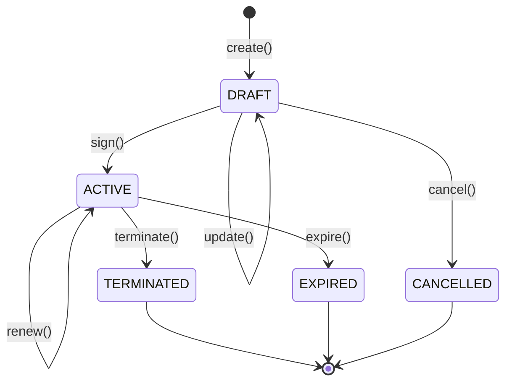

# Reglas de negocio

Fuente de verdad del **qué** hace el sistema. Todo lo que aparezca aquí debe estar implementado en la capa `domain` (invariantes) o `application` (orquestación) y cubierto por pruebas.

> **Estado del documento:** propuesta inicial. Las reglas marcadas con ⚖️ tienen base en la normativa laboral peruana y **deben validarse con RR.HH. / asesoría legal** antes de implementarse. Este documento no constituye asesoría legal.
> Cada regla lleva un identificador (`BR-XXX-NNN`) para referenciarla en código, tests y PRs.

## 1. Contexto del dominio

- **Negocio:** gestión del ciclo de vida de los contratos laborales de una organización: registro en borrador, firma, renovación, término y vencimiento.
- **Actores:**
  - **RR.HH.** (`HR`): crea, modifica, firma, renueva y termina contratos.
  - **Administrador** (`ADMIN`): todas las operaciones.
  - **Empleado** (`EMPLOYEE`): consulta solo sus propios contratos.
  - **Sistema**: procesa el vencimiento automático de contratos a plazo fijo.
- **Bounded context de este servicio:** Contratos laborales.
- **Fuera de alcance:** planillas y cálculo de beneficios (CTS, gratificaciones, vacaciones), asistencia, firma digital certificada, registro ante entidades del Estado.

## 2. Glosario (lenguaje ubicuo)

Usa exactamente estos términos en el código y en la documentación.

| Término (ES) | Término en código | Definición |
|---|---|---|
| Contrato laboral | `Contract` | Acuerdo entre la organización y un empleado que define cargo, remuneración y vigencia. Raíz del agregado. |
| Número de contrato | `ContractNumber` | Identificador legible y único, formato `CTR-AAAA-NNNNNN`. |
| Tipo de contrato | `ContractType` | `INDEFINITE` (plazo indeterminado) o `FIXED_TERM` (plazo fijo / sujeto a modalidad). |
| Vigencia | `ContractPeriod` | Fecha de inicio y, si aplica, fecha de fin del contrato. |
| Remuneración | `Salary` | Monto mensual bruto en soles (`Money` con moneda `PEN`). |
| Cargo | `JobTitle` | Puesto que ocupa el empleado en el contrato. |
| Renovación | `ContractRenewal` | Extensión de la fecha de fin de un contrato a plazo fijo vigente. |
| Término / cese | `Termination` | Fin anticipado de un contrato vigente, con motivo y fecha. |
| Empleado | `Employee` | Persona contratada, identificada por su documento. |
| Estado del empleado | `EmployeeStatus` | `ACTIVE` o `INACTIVE` (baja lógica). Un empleado nunca se elimina (BR-EMP-005). |
| Documento de identidad | `DocumentNumber` | DNI (8 dígitos) o carné de extranjería. |
| Tipo de documento | `DocumentType` | `DNI` o `FOREIGNER_CARD` (carné de extranjería). Cada tipo define su regla de formato: DNI de 8 dígitos (BR-EMP-002); carné de extranjería no vacío (formato pendiente, §9). |
| Estado del contrato | `ContractStatus` | `DRAFT`, `ACTIVE`, `TERMINATED`, `EXPIRED` o `CANCELLED`; transiciones en §5. |
| Dinero | `Money` | Monto no negativo con moneda y 2 decimales. Concepto del shared kernel. |
| RMV | `MinimumWage` | Remuneración Mínima Vital vigente; valor configurable, no fijo en código. |
| Usuario | `User` | Cuenta con la que una persona se autentica en la API. Raíz del agregado de identidad. |
| Nombre de usuario | `Username` | Identificador de inicio de sesión, único sin distinguir mayúsculas (BR-USR-001, 002). |
| Rol | `Role` / `RoleName` | Agrupación de permisos: `ADMIN`, `HR`, `EMPLOYEE`. La relación rol → permisos se guarda en base de datos (§4.1). |
| Permiso | `Permission` | Acción autorizada con formato `<recurso>:<acción>[:<alcance>]`, p. ej. `contract:read:own`. |
| Política de contraseñas | `PasswordPolicy` | Reglas que debe cumplir una contraseña (BR-USR-003). |
| Token de acceso | access token | JWT firmado de vida corta (15 min, configurable) que autentica cada petición. |
| Token de refresco | `RefreshToken` | Token opaco de vida larga (7 días, configurable) que permite obtener un nuevo token de acceso. De un solo uso (BR-USR-006). |
| Familia de tokens | `familyId` | Cadena de refresh tokens que nacen de un mismo login; se revoca completa ante reutilización o logout. |

## 3. Entidades y agregados

### Agregado `Contract`

| Atributo | Tipo | Reglas |
|---|---|---|
| `id` | `ContractId` (UUID) | Generado al crear. Inmutable. |
| `number` | `ContractNumber` | Generado por el sistema. Único. Inmutable. |
| `employeeId` | `EmployeeId` | Obligatorio. Debe existir el empleado. |
| `type` | `ContractType` | Obligatorio. |
| `jobTitle` | `JobTitle` | Obligatorio, 3–100 caracteres. |
| `salary` | `Salary` | Obligatorio. Ver BR-CTR-004. |
| `period` | `ContractPeriod` | Ver BR-CTR-002 y BR-CTR-003. |
| `status` | `ContractStatus` | Ver sección 5. |
| `renewals` | `List<ContractRenewal>` | Historial de renovaciones. Solo `FIXED_TERM`. |
| `termination` | `Termination` | Solo presente si el estado es `TERMINATED`. |

### Agregado `Employee`

| Atributo | Tipo | Reglas |
|---|---|---|
| `id` | `EmployeeId` (UUID) | Generado al registrar. Inmutable. |
| `documentNumber` | `DocumentNumber` | Obligatorio y único (tipo + número). Inmutable (BR-EMP-003). |
| `fullName` | `FullName` | Nombres y apellidos obligatorios. |
| `email` | `Email` | Obligatorio, formato válido. |
| `status` | `EmployeeStatus` | `ACTIVE` al registrar. Solo cambia al desactivar o reactivar (BR-EMP-005, 006, 008). |

### Agregado `User`

| Atributo | Tipo | Reglas |
|---|---|---|
| `id` | `UserId` (UUID) | Generado al crear. Inmutable. |
| `username` | `Username` | Obligatorio y único. Ver BR-USR-001 y BR-USR-002. |
| `passwordHash` | `PasswordHash` | Hash con prefijo de algoritmo (`{bcrypt}...`). Nunca se guarda la contraseña en claro. |
| `roles` | `Set<RoleName>` | Roles asignados; los permisos efectivos son la unión de los permisos de sus roles. |
| `enabled` | `boolean` | Un usuario deshabilitado no puede autenticarse (BR-USR-004). |

La relación `User` ↔ `Employee` está pendiente (§9) y es necesaria para BR-CTR-012.

## 4. Invariantes y reglas

| ID | Regla | Capa | Error |
|---|---|---|---|
| BR-CTR-001 | Un contrato debe pertenecer a un empleado existente. | application | `EMP-404` |
| BR-CTR-002 | La fecha de inicio es obligatoria. | domain | `CTR-001` |
| BR-CTR-003 | `FIXED_TERM` exige fecha de fin posterior a la de inicio; `INDEFINITE` no tiene fecha de fin. | domain | `CTR-001` |
| BR-CTR-004 ⚖️ | La remuneración mensual (jornada completa) no puede ser menor que la RMV vigente. | domain | `CTR-002` |
| BR-CTR-005 | Un empleado no puede tener dos contratos `ACTIVE` con vigencias que se superpongan. | application | `CTR-003` |
| BR-CTR-006 | Solo los contratos en `DRAFT` pueden modificarse. | domain | `CTR-004` |
| BR-CTR-007 | Solo se renueva un contrato `FIXED_TERM` en estado `ACTIVE`; la nueva fecha de fin debe ser posterior a la actual. | domain | `CTR-005` |
| BR-CTR-008 ⚖️ | La duración acumulada de contratos a plazo fijo con el mismo empleado no puede superar 5 años. | application | `CTR-006` |
| BR-CTR-009 | El término exige motivo y una fecha entre el inicio del contrato y su fecha de fin (si tiene). | domain | `CTR-007` |
| BR-CTR-010 | El número de contrato lo genera el sistema con formato `CTR-AAAA-NNNNNN` y es único. | application | — |
| BR-CTR-011 | Crear, modificar, firmar, renovar, terminar y cancelar contratos requiere el permiso correspondiente (`contract:<acción>`), que tienen los roles `HR` y `ADMIN` (§4.1). | infrastructure/api (`@PreAuthorize`) | `AUTH-001` |
| BR-CTR-012 | Un empleado solo puede consultar sus propios contratos (`contract:read:own`); con `contract:read:all` se consulta cualquiera. | application | `AUTH-001` |
| BR-EMP-001 | El documento de identidad de un empleado es único. | application | `EMP-001` |
| BR-EMP-002 | El DNI tiene exactamente 8 dígitos. | domain | `EMP-002` |
| BR-EMP-003 | Tras el registro solo se actualizan nombres y correo; el documento de identidad no se modifica. El estado solo cambia al desactivar o reactivar. | domain | — |
| BR-EMP-004 | Hay dos formas de búsqueda de empleados, excluyentes: por documento, exacta (tipo + número; devuelve 0 o 1 empleado por BR-EMP-001), o por nombre, parcial y sin distinguir mayúsculas ni tildes (en nombres y apellidos). No se combinan. | application | `VAL-001` |
| BR-EMP-005 ⚖️ | Un empleado no se elimina: se desactiva (`INACTIVE`) y puede reactivarse. Sus datos se conservan. | domain | — |
| BR-EMP-006 | No se puede desactivar un empleado que tenga algún contrato `ACTIVE`. | application | `EMP-003` |
| BR-EMP-007 | No se crean contratos para un empleado `INACTIVE` (complementa BR-CTR-001). | application | `EMP-004` |
| BR-EMP-008 | Solo se desactiva un empleado `ACTIVE` y solo se reactiva uno `INACTIVE`. | domain | `EMP-005` |
| BR-USR-001 | El nombre de usuario es único, sin distinguir mayúsculas. | application | `AUTH-007` |
| BR-USR-002 | El nombre de usuario tiene 3–50 caracteres: letras minúsculas, dígitos, `.`, `_` o `-`. Se normaliza a minúsculas. | domain | `VAL-001` |
| BR-USR-003 | La contraseña tiene entre 12 y 64 caracteres y no supera 72 bytes en UTF-8 (límite de BCrypt). Sin reglas de composición (NIST SP 800-63B). | domain | `AUTH-008` |
| BR-USR-004 | Un usuario deshabilitado no puede iniciar sesión ni refrescar tokens. Externamente se responde como credenciales inválidas. | application | `AUTH-002` |
| BR-USR-005 | Al deshabilitar un usuario o cambiar su contraseña se revocan todos sus refresh tokens. | application | — |
| BR-USR-006 | Un refresh token es de un solo uso: al usarlo se emite otro de la misma familia. Si se presenta uno ya usado, se revoca toda la familia. | domain / application | `AUTH-005` |
| BR-USR-007 | Al arrancar, si no existe ningún usuario con rol `ADMIN`, se crea uno con las credenciales de las variables de entorno `SECURITY_BOOTSTRAP_ADMIN_USERNAME` y `SECURITY_BOOTSTRAP_ADMIN_PASSWORD`. Nunca con contraseña fija en una migración. Si faltan, solo se registra un aviso; si no puede crearse (username ocupado por un usuario no `ADMIN` o contraseña que incumple BR-USR-003), la aplicación no arranca. | application | — |

### 4.1 Roles y permisos

La relación se carga con Flyway (`V3__seed_roles_permissions.sql`). Los permisos efectivos de un usuario son la unión de los de sus roles.

| Permiso | ADMIN | HR | EMPLOYEE |
|---|:-:|:-:|:-:|
| `employee:create`, `employee:update` | ✅ | ✅ | |
| `employee:read` | ✅ | ✅ | |
| `contract:create`, `contract:update`, `contract:sign`, `contract:renew`, `contract:terminate`, `contract:cancel` | ✅ | ✅ | |
| `contract:read:all` | ✅ | ✅ | |
| `contract:read:own` | | | ✅ |
| `user:manage` | ✅ | | |
| `system:monitor` | ✅ | | |

Sin permiso explícito (solo autenticado): consultar el usuario actual, cerrar sesión y cambiar la contraseña propia.

## 5. Estados y transiciones

- `renew()` y `expire()` solo aplican a contratos `FIXED_TERM`.
- `expire()` lo ejecuta el **Sistema** cuando la fecha actual supera la fecha de fin.
- Cualquier transición no dibujada lanza `InvalidContractStatusTransitionException` (`CTR-008`).
- Excepción: `renew()` sobre un contrato que no es `FIXED_TERM` en `ACTIVE` lanza `ContractNotRenewableException` (`CTR-005`), porque BR-CTR-007 es la regla específica.
- `expire(fechaCorte)` sobre un contrato que no es `FIXED_TERM` en `ACTIVE`, o cuya fecha de fin no es anterior a la fecha de corte, lanza `CTR-008`.

## 6. Casos de uso

| Caso de uso | Actor | Entrada | Salida | Reglas |
|---|---|---|---|---|
| `RegisterEmployeeUseCase` | HR, Admin | `RegisterEmployeeCommand` | `EmployeeResult` | BR-EMP-001, 002 |
| `UpdateEmployeeUseCase` | HR, Admin | `UpdateEmployeeCommand` | `EmployeeResult` | BR-EMP-003 |
| `GetEmployeeUseCase` | HR, Admin (`employee:read`) | `EmployeeQuery` | `EmployeeResult` | — |
| `ListEmployeesUseCase` | HR, Admin (`employee:read`) | `EmployeeSearchQuery` (documento, nombre, estado) | `Page<EmployeeResult>` | BR-EMP-004 |
| `DeactivateEmployeeUseCase` | HR, Admin (`employee:update`) | `DeactivateEmployeeCommand` | — | BR-EMP-005, 006, 008 |
| `ReactivateEmployeeUseCase` | HR, Admin (`employee:update`) | `ReactivateEmployeeCommand` | — | BR-EMP-005, 008 |
| `CreateContractUseCase` | HR, Admin | `CreateContractCommand` | `ContractResult` | BR-CTR-001–005, 010, 011, BR-EMP-007 |
| `UpdateContractUseCase` | HR, Admin | `UpdateContractCommand` | `ContractResult` | BR-CTR-003, 004, 006, 011 |
| `SignContractUseCase` | HR, Admin | `SignContractCommand` | `ContractResult` | BR-CTR-005, 011 |
| `RenewContractUseCase` | HR, Admin | `RenewContractCommand` | `ContractResult` | BR-CTR-007, 008, 011 |
| `TerminateContractUseCase` | HR, Admin | `TerminateContractCommand` | — | BR-CTR-009, 011 |
| `CancelContractUseCase` | HR, Admin | `CancelContractCommand` | — | BR-CTR-011 |
| `ExpireContractsUseCase` | Sistema | fecha de corte | cantidad vencida | Sección 5 |
| `GetContractUseCase` | HR, Admin, Empleado | `ContractQuery` | `ContractResult` | BR-CTR-012 |
| `ListContractsUseCase` | HR, Admin, Empleado | `ContractSearchQuery` (empleado, estado, tipo) | `Page<ContractResult>` | BR-CTR-012 |
| `AuthenticateUserUseCase` | Cualquiera | `LoginCommand` | `TokenPairResult` | BR-USR-004 |
| `RefreshTokenUseCase` | Cualquiera con refresh token | `RefreshTokenCommand` | `TokenPairResult` | BR-USR-004, 006 |
| `LogoutUseCase` | Autenticado | `LogoutCommand` | — | BR-USR-006 |
| `GetCurrentUserUseCase` | Autenticado | `CurrentUserQuery` | `CurrentUserResult` | — |
| `CreateUserUseCase` | `user:manage` | `CreateUserCommand` | `UserResult` | BR-USR-001–003 |
| `BootstrapAdministratorUseCase` | Sistema (arranque) | `BootstrapAdministratorCommand` | creado o no | BR-USR-001–003, 007 |

### Detalle: `RefreshTokenUseCase`

1. Buscar el refresh token por su hash, bloqueando la fila; si no existe → `AUTH-005`.
2. Si ya fue usado → revocar su familia y responder `AUTH-005` (BR-USR-006). La revocación se confirma aunque la operación falle.
3. Si está revocado o expirado → `AUTH-005`.
4. Si el usuario no existe o está deshabilitado → revocar la familia y `AUTH-005` (BR-USR-004).
5. Marcar el token como usado, emitir uno nuevo de la misma familia y un nuevo access token.

### Detalle: `UpdateEmployeeUseCase`

1. Cargar el empleado (`EmployeeRepositoryPort`); si no existe → `EMP-404`.
2. Reemplazar nombres y correo (actualización completa); el dominio valida el formato (`VAL-001`). El documento no cambia — BR-EMP-003.
3. Persistir y devolver `EmployeeResult`.

No tiene restricciones por estado de los contratos del empleado ni emite evento de dominio.

### Detalle: `ListEmployeesUseCase`

1. Filtros opcionales: documento (tipo + número, exacto) **o** nombre (parcial, sin mayúsculas ni tildes, en nombres y apellidos); documento y nombre no se combinan (BR-EMP-004). Además, estado (`ACTIVE` por defecto; `INACTIVE` o todos si se indica). El filtro por estado se incorpora junto con `DeactivateEmployeeUseCase`; hasta entonces todos los empleados están activos.
2. Paginado y ordenado según `architecture.md` §6 (por defecto, apellidos ascendente).

### Detalle: `DeactivateEmployeeUseCase`

1. Cargar el empleado; si no existe → `EMP-404`.
2. Si tiene algún contrato `ACTIVE` → `EMP-003` (BR-EMP-006).
3. El dominio pasa el estado a `INACTIVE`; si ya lo estaba → `EMP-005` (BR-EMP-008).
4. Persistir. No elimina datos ni modifica sus contratos (BR-EMP-005).

`ReactivateEmployeeUseCase` sigue los pasos 1, 3 (hacia `ACTIVE`) y 4, sin el paso 2.

### Detalle: `CreateContractUseCase`

1. Verificar que el empleado existe (`EmployeeRepositoryPort`) — BR-CTR-001.
2. Obtener la RMV vigente (`MinimumWagePort`).
3. Construir el agregado `Contract` en estado `DRAFT`; el dominio valida BR-CTR-002, 003 y 004.
4. Verificar que no haya contratos activos superpuestos (`ContractRepositoryPort`) — BR-CTR-005.
5. Generar el número de contrato — BR-CTR-010.
6. Persistir y devolver `ContractResult`.

### Detalle: `RenewContractUseCase`

1. Cargar el contrato; si no existe → `CTR-404`.
2. El dominio valida estado, tipo y nueva fecha de fin — BR-CTR-007.
3. Sumar la duración de todos los contratos a plazo fijo del empleado más la extensión — BR-CTR-008.
4. Registrar la `ContractRenewal` y persistir.

## 7. Eventos de dominio

Todos los eventos incluyen además `eventId` (UUID), `occurredOn` (instante en que ocurrió) y `aggregateId` (el `contractId`). Los emite el agregado `Contract` dentro de sus métodos de comportamiento.

| Evento | Se emite cuando | Datos |
|---|---|---|
| `ContractCreated` | Se crea un contrato en borrador | `contractId`, `employeeId`, `type` |
| `ContractSigned` | El contrato pasa a `ACTIVE` | `contractId`, `startDate` |
| `ContractRenewed` | Se renueva un contrato | `contractId`, `previousEndDate`, `newEndDate` |
| `ContractTerminated` | Se termina un contrato | `contractId`, `terminationDate`, `reason` |
| `ContractExpired` | Vence un contrato a plazo fijo | `contractId`, `endDate` |

## 8. Catálogo de errores de negocio

| Código | Excepción | HTTP | Mensaje |
|---|---|---|---|
| `CTR-001` | `InvalidContractPeriodException` | 422 | La vigencia del contrato no es válida para su tipo. |
| `CTR-002` | `SalaryBelowMinimumWageException` | 422 | La remuneración es menor que la RMV vigente. |
| `CTR-003` | `OverlappingActiveContractException` | 409 | El empleado ya tiene un contrato activo en ese periodo. |
| `CTR-004` | `ContractNotEditableException` | 422 | Solo se pueden modificar contratos en borrador. |
| `CTR-005` | `ContractNotRenewableException` | 422 | El contrato no puede renovarse. |
| `CTR-006` | `FixedTermLimitExceededException` | 422 | Se supera la duración máxima acumulada de contratos a plazo fijo. |
| `CTR-007` | `InvalidTerminationException` | 422 | El motivo o la fecha de término no son válidos. |
| `CTR-008` | `InvalidContractStatusTransitionException` | 409 | La operación no está permitida en el estado actual del contrato. |
| `CTR-404` | `ContractNotFoundException` | 404 | El contrato no existe. |
| `EMP-001` | `DuplicateEmployeeDocumentException` | 409 | Ya existe un empleado con ese documento. |
| `EMP-002` | `InvalidDocumentNumberException` | 422 | El documento de identidad no es válido. |
| `EMP-003` | `EmployeeHasActiveContractsException` | 409 | El empleado tiene contratos activos y no puede desactivarse. |
| `EMP-004` | `InactiveEmployeeException` | 422 | El empleado está inactivo. |
| `EMP-005` | `InvalidEmployeeStatusTransitionException` | 409 | El empleado ya está en el estado solicitado. |
| `EMP-404` | `EmployeeNotFoundException` | 404 | El empleado no existe. |
| `AUTH-001` | `AccessDeniedException` | 403 | No tiene permisos sobre este recurso. |
| `AUTH-002` | `InvalidCredentialsException` | 401 | Usuario o contraseña incorrectos (también si el usuario está deshabilitado, si el username no tiene un formato válido o si la contraseña supera 72 bytes; el motivo real solo se audita). |
| `AUTH-003` | — (filtro de seguridad) | 401 | Token de acceso ausente o inválido. |
| `AUTH-004` | — (filtro de seguridad) | 401 | Token de acceso expirado. |
| `AUTH-005` | `InvalidRefreshTokenException` | 401 | El refresh token no existe, expiró, fue revocado o reutilizado. |
| `AUTH-006` | — (solo auditoría) | — | Usuario deshabilitado. Externamente se responde `AUTH-002`. |
| `AUTH-007` | `DuplicateUsernameException` | 409 | Ya existe un usuario con ese nombre. |
| `AUTH-008` | `WeakPasswordException` | 422 | La contraseña no cumple la política. |
| `AUTH-009` | `RoleNotFoundException` | 404 | El rol no existe. |
| `AUTH-404` | `UserNotFoundException` | 404 | El usuario no existe. |
| `VAL-001` | `InvalidValueException` | 422 | Un valor no cumple el formato requerido por el dominio (cargo, nombre, correo, monto). |

## 9. Preguntas abiertas

Reglas pendientes de confirmar. Claude no debe implementar suposiciones sobre estos puntos.

- [ ] ⚖️ ¿Se validan BR-CTR-004 y BR-CTR-008 tal como están? ¿Cómo se trata la remuneración en contratos a tiempo parcial?
- [ ] ¿Se distinguen las modalidades de plazo fijo (inicio de actividad, necesidad de mercado, obra determinada, etc.) o basta con `FIXED_TERM`?
- [ ] ¿Se registra el periodo de prueba en el contrato? ¿Con qué duración según el tipo de trabajador?
- [x] ¿De dónde se obtiene la RMV vigente? → Propiedad `contract.minimum-wage` en `application.yml` (ADR-0002).
- [ ] ¿Qué motivos de término se admiten? ¿Se manejan como catálogo cerrado? (Mientras tanto, texto libre obligatorio según BR-CTR-009.)
- [ ] ¿El vencimiento se procesa con una tarea programada diaria? Definir su ubicación en `infrastructure` (p. ej. `infrastructure/scheduler/`).
- [ ] ¿Los eventos de dominio se publican a otros sistemas? Hoy no hay adaptador de mensajería en la arquitectura.
- [ ] ¿Se requiere adjuntar el documento firmado (PDF) al contrato?
- [ ] ¿Solo moneda `PEN`? (Mientras tanto, `Salary` exige `PEN` según el glosario.)
- [ ] ¿Qué formato tiene el carné de extranjería? Hoy solo se exige que no esté vacío.
- [ ] ¿Qué valor tiene la RMV vigente y desde qué fecha? Confirmar con RR.HH. el valor de `contract.minimum-wage`.
- [ ] ⚖️ ¿Cuánto tiempo deben conservarse los datos de un empleado inactivo? ¿Se anonimizan al vencer ese plazo? (Mientras tanto, se conservan indefinidamente — BR-EMP-005.)
- [ ] ¿El rol `EMPLOYEE` puede consultar su propia ficha de empleado? Depende del vínculo `User` ↔ `Employee` (siguiente pregunta). (Mientras tanto, solo `employee:read`.)
- [ ] ¿Un `User` se vincula como máximo a un `Employee`? ¿Es obligatorio para el rol `EMPLOYEE`? ¿Quién crea el vínculo? (Necesario para BR-CTR-012.)
- [ ] ¿Solo `ADMIN` gestiona usuarios o `HR` puede crear usuarios `EMPLOYEE`? ¿Un usuario puede tener varios roles, o ninguno? (Mientras tanto, `user:manage` solo para `ADMIN` y se admiten varios roles.)
- [ ] ¿Se bloquea la cuenta tras N intentos fallidos? ¿Con qué umbral y duración? (Mientras tanto, sin bloqueo.)
- [ ] ¿Cuánto tiempo se retienen los registros de auditoría de seguridad? ¿Se purgan automáticamente?
- [ ] ¿El refresh token de la SPA viaja en el body o en una cookie `HttpOnly`? (Mientras tanto, en el body.)
- [x] Vida de los tokens y política de contraseñas → access 15 min, refresh 7 días (configurables); contraseña de 12–64 caracteres y ≤ 72 bytes (BR-USR-003).
