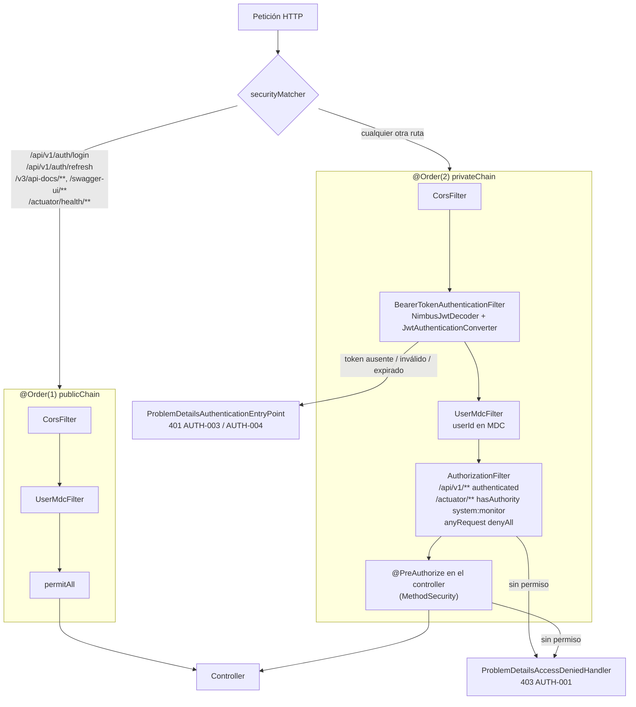
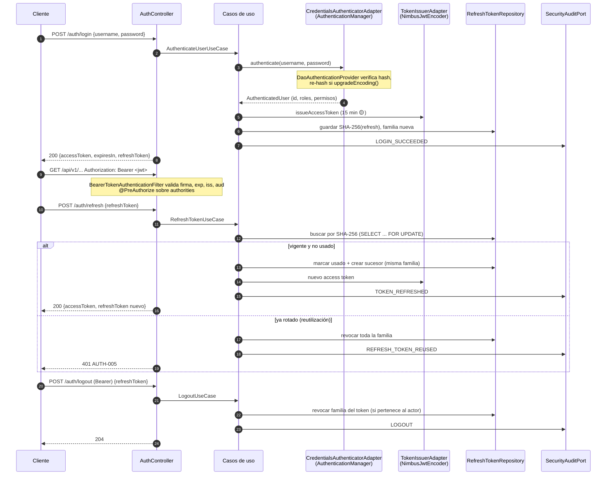
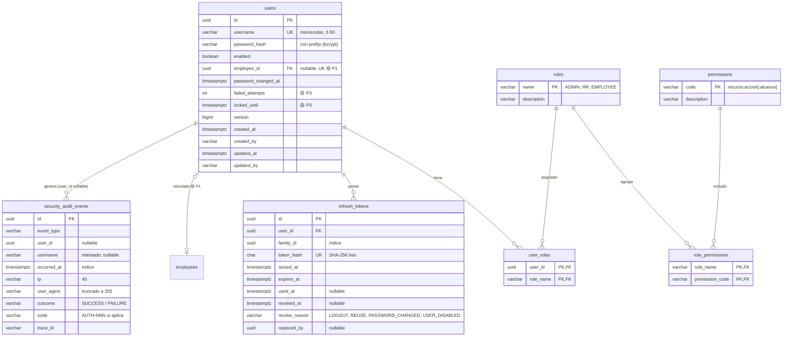

# Diseño de seguridad (3A) — contract-api

- **Estado:** Aprobado; fase 1 completada (2026-10-16, ver §5 "Estado de la fase 1"); fase 2 pendiente
- **Fecha:** 2026-10-03
- **Origen:** `docs/prompts/003-security-01.md`
- **Decisiones previas:** C1 = se reemplaza ADR-0001 (se incorpora seguridad). C2 = se mantiene ADR-0003 (sin ArchUnit). Implementación por fases.

> Lo marcado con 🟡 depende de una pregunta abierta (§7) y no se implementará hasta tener respuesta;
> mientras tanto queda como parámetro configurable o fuera del alcance.

---

## 1. Diseño general

### 1.1 Decisiones técnicas clave

| Tema | Decisión propuesta | Motivo |
|---|---|---|
| Validación del access token | `oauth2ResourceServer().jwt()` con `NimbusJwtDecoder` propio (clave pública RSA, validadores de `iss`, `aud`, `exp`, `nbf`) y `JwtAuthenticationConverter` que mapea el claim `perms` a authorities. **Sin `JwtAuthenticationFilter` propio.** | Validación probada y mantenida por Spring; `BearerTokenAuthenticationFilter`, manejo de cabeceras `WWW-Authenticate` y `jwt()` en `spring-security-test` gratis. Un filtro propio duplicaría lógica crítica (ver §6, ADR-0007). |
| Emisión del access token | `NimbusJwtEncoder` (RS256, RSA 2048), cabecera `kid` para rotar claves. | Nimbus ya viene con `spring-security-oauth2-jose`; no hace falta otra librería JWT. |
| Claves | PEM desde variables de entorno (`SECURITY_JWT_PRIVATE_KEY`, `SECURITY_JWT_PUBLIC_KEY`). Solo en el perfil `local`, si no existen, se genera un par efímero al arrancar (los tokens se invalidan al reiniciar). | Nunca hay claves en el repositorio. |
| Refresh token | Opaco, 256 bits aleatorios (`SecureRandom`), Base64URL. Se guarda su **SHA-256** (no BCrypt: tiene entropía alta y el hash debe permitir búsqueda). Familia (`family_id`) + rotación + detección de reutilización. | Revocable en BD, sin estado en el JWT. |
| Login | `AuthenticateUserUseCase` (application) delega la verificación de credenciales en el puerto `CredentialsAuthenticatorPort`, implementado en infraestructura con `AuthenticationManager` → `DaoAuthenticationProvider` + `UserDetailsService` + `UserDetailsPasswordService`. | Cumple lo pedido (UserDetailsService, AuthenticationProvider, re-hash transparente, eventos de Spring) sin que `application` conozca Spring Security. |
| Autorización gruesa | `@EnableMethodSecurity` + `@PreAuthorize("hasAuthority('contract:create')")` en los controllers (`infrastructure/api`). | Sobre authorities, no roles. Es la única dependencia de `api` hacia Spring Security. |
| Autorización por propiedad (BR-CTR-012) | Record `Actor` en `application/dto` (`userId`, `employeeId` opcional, `permissions`), incluido **solo** en los Commands/Queries que lo necesitan (`ContractQuery`, `ContractSearchQuery`, cambio de contraseña propia, logout). El controller lo construye desde el `Jwt`. | Explícito y testeable; sin `ThreadLocal` ni dependencia de Spring en `application`. |
| Sesión / CSRF | `STATELESS`; CSRF **deshabilitado**. | El token viaja en `Authorization: Bearer`, que el navegador no envía automáticamente; no hay cookie de sesión que un sitio ajeno pueda aprovechar. Si el refresh token pasara a cookie (🟡 P6), `/auth/refresh` necesitaría protección CSRF. |
| Correlación | `traceId`/`spanId` ya los pone Micrometer Tracing en el MDC. El filtro propio (`UserMdcFilter`) solo añade `userId` (no el username) y devuelve `X-Trace-Id` en la respuesta. | Evita duplicar lo que ya hace el stack. |
| Errores en filtros | `ProblemDetailsAuthenticationEntryPoint` (401) y `ProblemDetailsAccessDeniedHandler` (403) que escriben `application/problem+json` con `code`. | Los errores de los filtros no pasan por `@RestControllerAdvice`. |
| Password encoder | `DelegatingPasswordEncoder` construido a medida: `{bcrypt}` por defecto (strength configurable), `{pbkdf2}` y (fase 4) `{argon2}`. Re-hash con `upgradeEncoding` (cambio de prefijo o de strength) vía `UserDetailsPasswordService`. Expuesto a `application` como `PasswordHasherPort`. | Spring Security 6.5 lanza excepción si la contraseña supera 72 bytes en BCrypt: la `PasswordPolicy` del dominio lo impide antes. |
| Arquitectura sin ArchUnit (C2) | `domain` y `application` no declaran `spring-security-*` en su `pom.xml`, así que una importación prohibida no compila. La regla "`api` solo usa anotaciones de `security`" queda para revisión de código. | ADR-0003 se mantiene. |

### 1.2 Cadenas de filtros



- Ambas cadenas: `sessionManagement(STATELESS)`, `csrf.disable()`, `httpBasic/formLogin.disable()`.
- En `prod`, Swagger/OpenAPI se desactiva por propiedades de springdoc (la ruta pública queda sin destino).

### 1.3 Flujo login → acceso → refresh → logout



### 1.4 Ubicación en la arquitectura

```
domain/identity/
  model/       User (raíz), Role (raíz, solo lectura en v1)
  vo/          UserId, Username, PasswordHash, RoleName, Permission, PasswordPolicy
  exception/   WeakPasswordException, InvalidPermissionException, UserDisabledException ...
application/
  port/in/     AuthenticateUserUseCase, RefreshTokenUseCase, LogoutUseCase, GetCurrentUserUseCase,
               CreateUserUseCase, EnableUserUseCase, DisableUserUseCase, AssignRoleUseCase,
               RevokeRoleUseCase, ChangePasswordUseCase, BootstrapAdministratorUseCase
  port/out/    UserRepositoryPort, RoleRepositoryPort, RefreshTokenRepositoryPort,
               PasswordHasherPort, CredentialsAuthenticatorPort, TokenIssuerPort, SecurityAuditPort
  dto/         Actor, LoginCommand, TokenPairResult, CreateUserCommand, UserResult, ...
infrastructure/
  security/
    config/    SecurityFilterChainConfig, MethodSecurityConfig, CorsConfig, SecurityProperties
    jwt/       JwtKeyProvider, TokenIssuerAdapter, JwtDecoderConfig, PermissionsJwtConverter
    crypto/    PasswordEncoderConfig, PasswordHasherAdapter, RefreshTokenHasher
    filter/    UserMdcFilter
    handler/   ProblemDetailsAuthenticationEntryPoint, ProblemDetailsAccessDeniedHandler
    audit/     SecurityEventListener, SecurityAuditAdapter, SecurityAuditorAware
    authn/     DbUserDetailsService, CredentialsAuthenticatorAdapter
  persistence/ UserJpaEntity, RoleJpaEntity, PermissionJpaEntity, RefreshTokenJpaEntity,
               SecurityAuditEventJpaEntity + repositorios, mappers y adaptadores
  api/rest/    AuthController, UserController (+ ApiMappers)
  config/      BootstrapAdministratorRunner, registro de los nuevos casos de uso
```

`DbUserDetailsService` usa `UserRepositoryPort` (no el `JpaRepository` directamente), como pide el prompt.

---

## 2. Modelo de datos



> **Implementado en el paso 1.4:** `V2`–`V4` sin las columnas que dependen de decisiones pendientes o de fases posteriores: `employee_id` (P1), `failed_attempts`/`locked_until` (P3), `password_changed_at`, `version` y las columnas de auditoría (fase 3). Cada una llegará con su propia migración. Se añadieron `ck_users_username_lowercase` y `ck_refresh_tokens_revocation`.

Migraciones Flyway:

| Versión | Contenido |
|---|---|
| `V2__create_identity.sql` | `users`, `roles`, `permissions`, `role_permissions`, `user_roles` |
| `V3__seed_roles_permissions.sql` | Carga del catálogo de §3 (sin usuarios ni contraseñas) |
| `V4__create_refresh_tokens.sql` | `refresh_tokens` |
| `V5__create_security_audit_events.sql` | `security_audit_events` (fase 3) |
| `V6__add_audit_columns_employees.sql` | `created_at/by`, `updated_at/by` en `employees`, nullable para filas existentes (fase 3) |

El administrador inicial lo crea `BootstrapAdministratorRunner` al arrancar si existen
`SECURITY_BOOTSTRAP_ADMIN_USERNAME` y `SECURITY_BOOTSTRAP_ADMIN_PASSWORD` y no hay ningún usuario con rol `ADMIN`.
Si faltan, solo registra un aviso.

---

## 3. Catálogo de roles y permisos

| Permiso | Descripción | ADMIN | HR | EMPLOYEE |
|---|---|:-:|:-:|:-:|
| `employee:create` | Registrar empleado | ✅ | ✅ | |
| `employee:update` | Actualizar empleado | ✅ | ✅ | |
| `contract:create` | Crear contrato | ✅ | ✅ | |
| `contract:update` | Modificar contrato en borrador | ✅ | ✅ | |
| `contract:sign` | Firmar | ✅ | ✅ | |
| `contract:renew` | Renovar | ✅ | ✅ | |
| `contract:terminate` | Terminar | ✅ | ✅ | |
| `contract:cancel` | Cancelar | ✅ | ✅ | |
| `contract:read:all` | Consultar cualquier contrato | ✅ | ✅ | |
| `contract:read:own` | Consultar solo los propios (BR-CTR-012) | | | ✅ |
| `user:manage` | Crear usuarios, activar/desactivar, asignar/retirar roles | ✅ | 🟡 P2 | |
| `system:monitor` | Actuator distinto de `health` | ✅ | | |

- Sin permiso explícito (basta con estar autenticado): `GET /auth/me`, `POST /auth/logout`, cambio de la contraseña propia.
- `ExpireContractsUseCase` lo ejecuta el Sistema (tarea programada), no un endpoint HTTP: no necesita permiso.
- El JWT lleva `roles` (informativo) y `perms` (lo que usa la autorización). Un cambio en `role_permissions` se aplica en el siguiente refresh (≤ vida del access token).
- Un usuario puede tener varios roles; los permisos efectivos son la unión. 🟡 P2

---

## 4. Matriz endpoint × permiso

| Método y ruta | Caso de uso | Cadena | Permiso | Estado |
|---|---|---|---|---|
| `POST /api/v1/auth/login` | `AuthenticateUserUseCase` | pública | — | nuevo |
| `POST /api/v1/auth/refresh` | `RefreshTokenUseCase` | pública | — (refresh token) | nuevo |
| `POST /api/v1/auth/logout` | `LogoutUseCase` | privada | autenticado | nuevo |
| `GET /api/v1/auth/me` | `GetCurrentUserUseCase` | privada | autenticado | nuevo |
| `POST /api/v1/users` | `CreateUserUseCase` | privada | `user:manage` | nuevo |
| `POST /api/v1/users/{id}/enable` · `/disable` | `Enable/DisableUserUseCase` | privada | `user:manage` | nuevo |
| `PUT /api/v1/users/{id}/roles/{role}` · `DELETE` | `Assign/RevokeRoleUseCase` | privada | `user:manage` | nuevo |
| `PUT /api/v1/users/me/password` | `ChangePasswordUseCase` | privada | autenticado (actor = dueño) | nuevo |
| `POST /api/v1/employees` | `RegisterEmployeeUseCase` | privada | `employee:create` | **existe** |
| `PUT /api/v1/employees/{id}` | `UpdateEmployeeUseCase` | privada | `employee:update` | **existe** |
| `POST /api/v1/contracts` | `CreateContractUseCase` | privada | `contract:create` | planificado |
| `PUT /api/v1/contracts/{id}` | `UpdateContractUseCase` | privada | `contract:update` | planificado |
| `POST /api/v1/contracts/{id}/sign` | `SignContractUseCase` | privada | `contract:sign` | planificado |
| `POST /api/v1/contracts/{id}/renew` | `RenewContractUseCase` | privada | `contract:renew` | planificado |
| `POST /api/v1/contracts/{id}/terminate` | `TerminateContractUseCase` | privada | `contract:terminate` | planificado |
| `POST /api/v1/contracts/{id}/cancel` | `CancelContractUseCase` | privada | `contract:cancel` | planificado |
| `GET /api/v1/contracts/{id}` | `GetContractUseCase` | privada | `contract:read:all` **o** `contract:read:own` + propiedad en application | planificado |
| `GET /api/v1/contracts` · `/employees/{id}/contracts` | `ListContractsUseCase` | privada | ídem; con `read:own` se fuerza el filtro al empleado del actor | planificado |
| `GET /actuator/health/**` | — | pública | — | existe |
| `GET /actuator/{info,metrics}` | — | privada | `system:monitor` | existe (hoy abierto) |
| `/v3/api-docs/**`, `/swagger-ui/**` | — | pública (off en `prod`) | — | existe |

Hoy solo existen dos endpoints de negocio (empleados). BR-CTR-012 se implementa cuando existan
`GetContractUseCase` y `ListContractsUseCase`; esta propuesta deja listo el `Actor` y el permiso.

### Catálogo de errores `AUTH-NNN` propuesto

| Código | Excepción | HTTP | Cuándo |
|---|---|---|---|
| `AUTH-001` | `AccessDeniedException` | 403 | Sin permiso o sin propiedad del recurso (ya existe, deja de estar diferido) |
| `AUTH-002` | `InvalidCredentialsException` | 401 | Usuario o contraseña incorrectos **y también usuario deshabilitado o bloqueado** (no se revela cuál; el motivo real va a la auditoría) |
| `AUTH-003` | — (filtro) | 401 | Token ausente o inválido (firma, `iss`, `aud`) |
| `AUTH-004` | — (filtro) | 401 | Access token expirado |
| `AUTH-005` | `InvalidRefreshTokenException` | 401 | Refresh token inexistente, expirado, revocado o reutilizado |
| `AUTH-006` | `UserDisabledException` | 401* | Solo se usa como motivo en auditoría (*externamente sale `AUTH-002`) |
| `AUTH-007` | `DuplicateUsernameException` | 409 | Username ya existe |
| `AUTH-008` | `WeakPasswordException` | 422 | No cumple la `PasswordPolicy` |
| `AUTH-009` | `RoleNotFoundException` | 404 | Rol inexistente al crear o asignar |
| `AUTH-404` | `UserNotFoundException` | 404 | Usuario inexistente (gestión de usuarios) |

Cambios en `business-rules.md`: BR-CTR-011 pasa a la capa `infrastructure/api` (`@PreAuthorize`) porque es control de acceso y no regla de dominio; BR-CTR-012 sigue en `application`. Nuevas reglas `BR-USR-NNN` (unicidad de username, política de contraseñas, revocación al deshabilitar o cambiar contraseña, administrador inicial).

---

## 5. Plan de implementación por fases

Cada paso compila y deja `./mvnw clean verify` en verde.

### Fase 1 — Autenticación y usuarios

| Paso | Contenido | Pruebas |
|---|---|---|
| 1.0 | ADR-0005 "Incorporar seguridad" (reemplaza ADR-0001). Reglas `BR-USR-*`, catálogo `AUTH-*` y preguntas abiertas en `business-rules.md`. | — |
| 1.1 | `domain/identity`: `UserId`, `Username`, `PasswordHash`, `RoleName`, `Permission` (valida formato), `PasswordPolicy` (longitud en caracteres y ≤ 72 bytes UTF-8), `User`, `Role`, excepciones. | Unitarias de dominio |
| 1.2 | `application`: puertos de salida, DTOs, `CreateUser`, `BootstrapAdministrator`, `AuthenticateUser`, `RefreshToken`, `Logout`, `GetCurrentUser`. | Mockito: rotación, reutilización → revocación de familia, expiración, logout ajeno |
| 1.3 | `pom.xml` de `infrastructure`: `spring-boot-starter-security`, `spring-boot-starter-oauth2-resource-server` (Nimbus), `spring-security-test` (test). Cadenas pública/privada y handlers Problem Details. Ajuste de `EmployeeControllerTest` (ahora requiere `jwt()`). | `@WebMvcTest`: 401 sin token, rutas públicas |
| 1.4 | Persistencia: `V2`–`V4`, entidades JPA, mappers y adaptadores (`User`, `Role`, `RefreshToken`). | Testcontainers |
| 1.5 | `crypto`: `DelegatingPasswordEncoder` (bcrypt por defecto, pbkdf2), `PasswordHasherAdapter`, `RefreshTokenHasher`. | Unitarias: encode/matches, `upgradeEncoding` al cambiar strength o prefijo |
| 1.6 | `jwt`: `TokenIssuerAdapter` (emisión con `NimbusJwtEncoder`) y generación/hash del refresh token. *(La validación —`SecurityProperties`, `RsaKeys`, `JwtDecoder` con `iss`/`aud` y converter `perms`— se adelantó al paso 1.3 porque la cadena privada la necesita para arrancar.)* | Unitarias: claims emitidos, expiración |
| 1.7 | `authn`: `DbUserDetailsService`, `UserDetailsPasswordService`, `CredentialsAuthenticatorAdapter`. | Unitarias + re-hash en login |
| 1.8 | API: `AuthController`, `POST /users`, `BootstrapAdministratorRunner`, errores `AUTH-*` en `GlobalExceptionHandler`. OpenAPI con esquema `bearerAuth`. | `@WebMvcTest` éxito y errores |

#### Estado de la fase 1 (2026-10-16)

Pasos 1.0–1.8 ✅ completados (1.6–1.8 en `docs/prompts/005-security-02.md`). `./mvnw clean verify` en verde y verificación manual: arranque con perfil `local`, login con el administrador inicial y `POST /api/v1/employees` → `201`. Guía de prueba local: `docs/design/003-security-local-testing.md`.

**Desviaciones respecto al diseño**

| # | Diseño | Implementado | Motivo |
|---|---|---|---|
| D1 | §1.4: `JwtKeyProvider`, `JwtDecoderConfig`, `PermissionsJwtConverter` | `security/jwt/RsaKeys` y `JwtConfig` (decoder, encoder y converter `perms`); `TokenIssuerAdapter` | Una sola configuración garantiza que encoder y decoder usan el mismo `RsaKeys` (crítico con la clave efímera). |
| D2 | §1.4 no detalla el `AuthenticationManager` | `security/authn/AuthenticationConfig` + `UserAccountDetails` (envuelve el agregado `User`) | El login devuelve el agregado sin una segunda consulta. |
| D3 | §4: `POST /users` exige `user:manage` vía `@PreAuthorize` (fase 2) | Regla de URL **temporal** `/api/v1/users/** → hasAuthority('user:manage')` en `SecurityFilterChainConfig` | Sin ella, en la fase 1 cualquier autenticado podía crearse un `ADMIN`. Se retira en el paso 2.1. |
| D4 | §2: variables `SECURITY_BOOTSTRAP_ADMIN_*` | Propiedades `security.bootstrap.admin.username`/`.password` (anidadas), sin valores por defecto en ningún perfil | La estructura anidada hace que el nombre de la variable de entorno corresponda exactamente con la propiedad; los secretos nunca van al repositorio (architecture §8). |
| D5 | §2: si faltan las variables, solo un aviso | Igual; además, si el administrador no puede crearse (`AUTH-007`, `AUTH-008`, `VAL-001`) la aplicación **no arranca** | Decisión del paso 0: fallar pronto ante una configuración inválida. El mensaje no incluye la contraseña. |
| D6 | — | `CredentialsAuthenticatorAdapter` rechaza como `AUTH-002` las contraseñas de más de 72 bytes antes de autenticar | BCrypt (Spring Security 6.5.11) solo compara los primeros 72 bytes: una contraseña guardada de 72 bytes seguida de cualquier sufijo sería aceptada. Verificado con prueba. |
| D7 | — | Un username con formato inválido en el login responde `AUTH-002`, no `VAL-001` | No revelar información en el login (BR-USR-004). |
| D8 | §1.3: respuesta `{accessToken, expiresIn, refreshToken}` | Se añaden `tokenType: "Bearer"` y `refreshExpiresIn` (segundos); `Cache-Control: no-store` en `login` y `refresh` | Decisión técnica; facilita a los clientes programar el refresh. |
| D9 | — | `GlobalExceptionHandler`: `InvalidRefreshTokenException` → 401 (antes 422 por ser `DomainException`) y `UnauthenticatedException` → 401 (antes 500) | Errores detectados en el paso 0 sobre los pasos 1.2/1.3. |
| D10 | Bean `Clock` en el paso de wiring | `config/ClockConfig` (`Clock.systemUTC()`), creado junto con `TokenIssuerAdapter` | Mantener la aplicación arrancable en cada paso. |

**Trazabilidad (fase 1)**

| Regla / error | Pruebas principales |
|---|---|
| BR-USR-001 | `IdentityValueObjectsTest`, `CreateUserServiceTest`, `IdentityPersistenceAdapterTest`, `AuthenticationFlowIntegrationTest.shouldRejectDuplicateUsernameIgnoringCaseWhenUserIsCreated` |
| BR-USR-002 | `IdentityValueObjectsTest`, `CreateUserServiceTest.shouldRejectUserWhenUsernameIsInvalid`, `UserControllerTest.shouldReturnUnprocessableEntityWhenUsernameFormatIsInvalid` |
| BR-USR-003 | `PasswordPolicyTest`, `CreateUserServiceTest`, `BootstrapAdministratorServiceTest`, `CredentialsAuthenticatorAdapterTest.shouldThrowInvalidCredentialsWhenInputExtendsA72BytePassword` |
| BR-USR-004 | `AuthenticateUserServiceTest`, `RefreshTokenServiceTest.shouldRevokeFamilyWhenUserIsDisabled`, `CredentialsAuthenticatorAdapterTest`, `AuthenticationFlowIntegrationTest.shouldRejectLoginAndRefreshWhenUserIsDisabled` |
| BR-USR-005 | ⏳ Sin cobertura: los casos de uso llegan en el paso 2.2 |
| BR-USR-006 | `RefreshTokenTest`, `RefreshTokenServiceTest`, `RefreshTokenPersistenceAdapterTest`, `LogoutAndCurrentUserServiceTest`, `AuthenticationFlowIntegrationTest` (reutilización y logout) |
| BR-USR-007 | `BootstrapAdministratorServiceTest`, `BootstrapAdministratorRunnerTest`, `BootstrapAdministratorIntegrationTest` |
| AUTH-001 | `SecurityFilterChainTest`, `UserControllerTest.shouldReturnForbiddenWhenTokenLacksUserManagePermission`, `AuthenticationFlowIntegrationTest.shouldCarryRolePermissionsInTokenAndForbidUserManagementWhenUserIsHr` |
| AUTH-002 | `CredentialsAuthenticatorAdapterTest`, `AuthControllerTest`, `AuthenticationFlowIntegrationTest.shouldRespondInvalidCredentialsWhenPasswordIsWrongOrUserDoesNotExist` |
| AUTH-003 / AUTH-004 | `SecurityFilterChainTest`, `TokenIssuerAdapterTest`, `AuthControllerTest`, `UserControllerTest` |
| AUTH-005 | `RefreshTokenServiceTest`, `AuthControllerTest`, `AuthenticationFlowIntegrationTest` |
| AUTH-006 | ⏳ Fase 3 (auditoría); el efecto externo (`AUTH-002`) está cubierto en BR-USR-004 |
| AUTH-007 / 008 / 009 / 404 | `CreateUserServiceTest`, `UserControllerTest`, `BootstrapAdministratorRunnerTest`, `LogoutAndCurrentUserServiceTest`, `AuthControllerTest` |

**Pendientes para la fase 2**

| # | Pendiente | Referencia |
|---|---|---|
| T1 | `@EnableMethodSecurity` y `@PreAuthorize` en `EmployeeController` (`employee:create`/`employee:update`) y `UserController` (`user:manage`); retirar la regla de URL temporal D3 | Paso 2.1, BR-CTR-011, TODO en `EmployeeController`, `UserController` y `SecurityFilterChainConfig` |
| T2 | `GlobalExceptionHandler` captura `Exception` y respondería **500** a un `AccessDeniedException` lanzado por `@PreAuthorize`: añadir un handler que lo traduzca a 403 `AUTH-001` (o dejar que lo gestione `ExceptionTranslationFilter`) | Paso 2.1 |
| T3 | Casos de uso de gestión de usuarios (activar/desactivar, roles, cambio de contraseña propia) con revocación de refresh tokens | Paso 2.2, BR-USR-005 (hoy sin cobertura) |
| T4 | Record `Actor` en `application/dto`, construido desde el `Jwt` en `api`; usarlo en `logout`, `me` y las consultas de contratos | Paso 2.3, BR-CTR-012, P1 |
| T5 | CORS por propiedades y perfil, con fallo al arrancar si hay `*` con `allowCredentials=true`; exponer `Location` y `X-Trace-Id` | Paso 2.4 |
| T6 | Valorar si basta la vida corta del access token tras logout o deshabilitación (hoy válido ≤ 15 min) | §6 "Revocación de access tokens" |

### Fase 2 — Autorización

| Paso | Contenido | Pruebas |
|---|---|---|
| 2.1 | `@EnableMethodSecurity`; `@PreAuthorize` en `EmployeeController` y `UserController`. | `@WebMvcTest`: 403 sin authority, 2xx con authority |
| 2.2 | Gestión de usuarios: activar/desactivar, asignar/retirar rol, cambiar contraseña propia; revocación de refresh tokens. | Unitarias + slice |
| 2.3 | `Actor` en `application/dto` y su construcción desde el `Jwt` en `api`. Aplicación de BR-CTR-012 cuando existan los casos de uso de consulta de contratos. | Unitarias |
| 2.4 | CORS por propiedades y perfil; falla al arrancar si hay `*` con `allowCredentials=true`. Cabeceras expuestas: `Location`, `X-Trace-Id`. | `@WebMvcTest`: preflight permitido y rechazado |

### Fase 3 — Auditoría

| Paso | Contenido | Pruebas |
|---|---|---|
| 3.1 | `V5`, `SecurityAuditPort` + adaptador; eventos propios desde los casos de uso (refresh, reutilización, logout, alta de usuario, cambio de roles). | Unitarias + Testcontainers |
| 3.2 | `SecurityEventListener`: `AuthenticationSuccessEvent` (solo login con usuario y contraseña, no cada petición con JWT), `AbstractAuthenticationFailureEvent`, `AuthorizationDeniedEvent` (requiere bean `AuthorizationEventPublisher`). IP y user-agent desde la petición. | Unitarias |
| 3.3 | `UserMdcFilter` (`userId` en MDC, `X-Trace-Id`). | Slice |
| 3.4 | Spring Data JPA Auditing: `@EnableJpaAuditing`, `SecurityAuditorAware`, `V6` en `employees`. | Testcontainers |
| 3.5 | Retención de auditoría 🟡 P5. | — |

### Fase 4 — Endurecimiento

| Paso | Contenido |
|---|---|
| 4.1 | Argon2id en el `DelegatingPasswordEncoder`. **Requiere `org.bouncycastle:bcprov-jdk18on`**; solo si se confirma que hace falta. |
| 4.2 | Bloqueo por intentos fallidos 🟡 P3. |
| 4.3 | ADR-0006 (estrategia de tokens), ADR-0007 (resource server vs filtro propio), ADR-0008 (modelo RBAC); actualizar `architecture.md` §2, §3, §6, §8 y `CLAUDE.md` (stack). |

---

## 6. Riesgos y trade-offs

| Tema | Opción elegida | Se gana | Se pierde / riesgo | Mitigación |
|---|---|---|---|---|
| Filtro propio vs resource server | Resource server + `JwtDecoder`/converter propios | Validación estándar y probada, menos código, `jwt()` en tests, `WWW-Authenticate` conforme a RFC 6750 | Menos control sobre el formato del 401 y acoplamiento a la convención de Spring | `AuthenticationEntryPoint` propio para Problem Details. Un filtro propio facilitaría lógica extra por petición (lista negra), pero hoy no se necesita. |
| Revocación de access tokens | No se revocan; vida corta | Sin consulta a BD por petición; stateless | Un usuario deshabilitado o con contraseña cambiada mantiene acceso hasta que expire el token (≤ 15 min 🟡) | Vida corta + revocación inmediata de refresh tokens. Si no basta: claim `ver` comparado con BD o lista de `jti` revocados (cuesta una consulta por petición). |
| Rotación de refresh tokens | Rotación + reutilización ⇒ revocar familia | Detecta robo de refresh tokens | Dos peticiones de refresh concurrentes legítimas (pestañas, reintentos de red) se ven como reutilización y cierran la sesión | `SELECT … FOR UPDATE` para serializar; documentar en el cliente que no paralelice el refresh. Opcional: ventana de gracia de pocos segundos (no incluida). |
| Refresh token en el body | Body JSON 🟡 P6 | Sirve igual para SPA y servicios; sin CSRF | En la SPA el token queda expuesto a XSS si se guarda en JS | Alternativa: cookie `HttpOnly; Secure; SameSite=Strict; Path=/api/v1/auth` + CSRF en `/refresh`. |
| Hash del refresh token | SHA-256 | Búsqueda directa por índice | Si se filtra la BD, no hay *work factor* | 256 bits de entropía hacen inviable la fuerza bruta; es la práctica estándar. |
| Permisos en el JWT | Claim `perms` | Autorización sin BD | Token más grande; cambios de permisos con retraso | Catálogo pequeño (~12 permisos). |
| Errores de login genéricos | `AUTH-002` para todo | No se puede averiguar qué usuarios existen ni su estado | Peor diagnóstico para soporte | El motivo real va a la auditoría. `DaoAuthenticationProvider` ya hace un hash ficticio cuando el usuario no existe (mitiga diferencias de tiempo). |
| Sin ArchUnit (C2) | Módulos Maven | Sin dependencia nueva | La regla "`api` solo usa anotaciones de `security`" no se verifica automáticamente | Prompt de revisión (§5 de `prompts.md`). |
| Alcance | Por fases | Cada fase entrega valor y se puede revisar | Entre la fase 1 y la 2 cualquier usuario autenticado puede llamar a todo | No desplegar fuera de entornos controlados hasta completar la fase 2. |

---

## 7. Preguntas abiertas

Pasarán a `business-rules.md` §9 si no se responden. Los valores entre paréntesis son solo propuestas.

| # | Pregunta | Impacto si no se responde |
|---|---|---|
| P1 | ¿Un `User` se vincula como máximo a un `Employee`? ¿Es obligatorio para el rol `EMPLOYEE`? ¿Quién crea el vínculo? | Sin esto no se puede implementar BR-CTR-012. La columna `employee_id` se crea nullable. |
| P2 | ¿Solo `ADMIN` gestiona usuarios o `HR` puede crear usuarios `EMPLOYEE`? ¿Un usuario puede tener varios roles? | `user:manage` solo para `ADMIN`; varios roles permitidos a nivel de modelo. |
| P3 | ¿Hay bloqueo por intentos fallidos? ¿Con qué umbral y por cuánto tiempo? | Sin bloqueo; se crean las columnas pero no se usan. |
| P4 ✅ | Vida de los tokens y política de contraseñas | **Resuelta:** access 15 min, refresh 7 días; contraseña 12–64 caracteres, ≤ 72 bytes (BR-USR-003). |
| P5 | ¿Cuánto tiempo se retiene la auditoría de seguridad? ¿Se purga automáticamente? | Sin purga. |
| P6 | Refresh token para la SPA: ¿en el body o en una cookie `HttpOnly`? | Body (ver §6). |
