# Guía de arquitectura de contract-api

Explicación visual de cómo está construido `contract-api`: qué piezas tiene, cómo se conectan y por dónde pasa una petición. Está pensada para quien llega al proyecto y necesita orientarse antes de tocar código.

- Las **reglas** de arquitectura (lo que es obligatorio) están en [architecture.md](../architecture.md). Esta guía las explica con ejemplos del código; si hay contradicción, manda `architecture.md`.
- El **estado implementado** (endpoints, configuración, base de datos) está en [technical.md](../technical.md).
- Las **reglas de negocio** están en [business-rules.md](../business-rules.md).

## Índice

1. [Vista de contexto](#1-vista-de-contexto)
2. [Vista de contenedores y despliegue](#2-vista-de-contenedores-y-despliegue)
3. [Módulos y regla de dependencia](#3-módulos-y-regla-de-dependencia)
4. [Puertos y adaptadores](#4-puertos-y-adaptadores)
5. [Cómo se ensambla: casos de uso como beans](#5-cómo-se-ensambla-casos-de-uso-como-beans)
6. [Modelo de dominio](#6-modelo-de-dominio)
7. [Recorrido de una petición](#7-recorrido-de-una-petición)
8. [Autenticación y tokens](#8-autenticación-y-tokens)
9. [Manejo de errores](#9-manejo-de-errores)
10. [Ciclos de vida](#10-ciclos-de-vida)
11. [Pruebas por capa](#11-pruebas-por-capa)
12. [Cómo añadir una funcionalidad](#12-cómo-añadir-una-funcionalidad)
13. [Observaciones](#13-observaciones)

## 1. Vista de contexto

Quién usa el sistema y con qué se comunica. Hoy la API solo depende de PostgreSQL; no hay integraciones con sistemas externos.

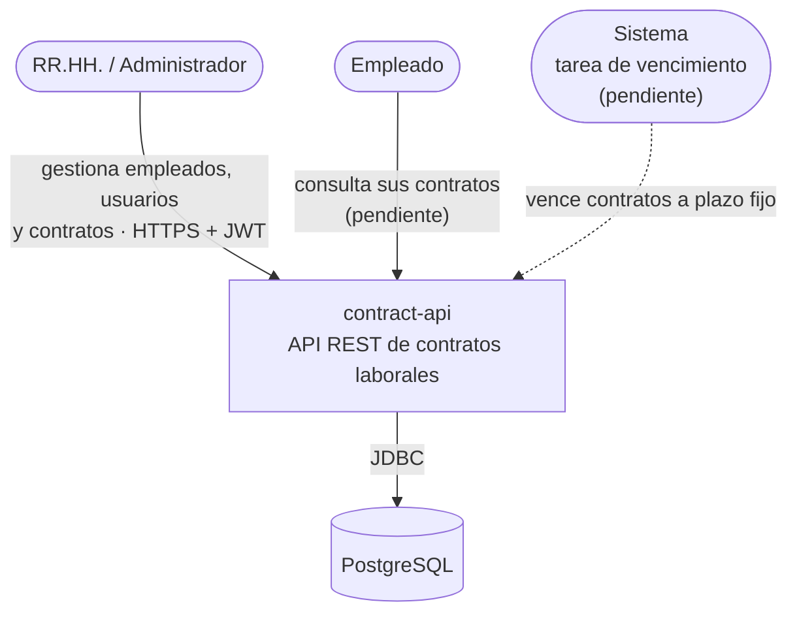

| Actor | Qué hace hoy | Pendiente |
|---|---|---|
| RR.HH. / Administrador | Inicia sesión, registra y consulta empleados; el administrador crea usuarios | Operaciones de contratos |
| Empleado | Puede iniciar sesión | Consultar sus contratos (requiere el vínculo `User` ↔ `Employee`, business-rules §9) |
| Sistema | Crea el administrador inicial al arrancar (BR-USR-007) | Vencimiento automático de contratos |

## 2. Vista de contenedores y despliegue

La API es un único proceso Spring Boot empaquetado en una imagen Docker. En local, la base de datos y pgAdmin se levantan con `docker compose`.

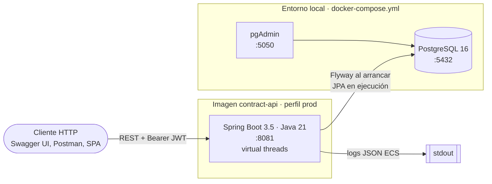

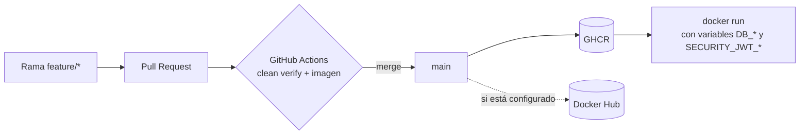

El detalle del pipeline está en la [guía de CI/CD](ci-cd.md); las variables de entorno, en [technical.md §4](../technical.md#4-configuración).

## 3. Módulos y regla de dependencia

El proyecto Maven tiene tres módulos. Las dependencias apuntan **solo hacia el centro**: el dominio no conoce a nadie y la infraestructura conoce a todos.

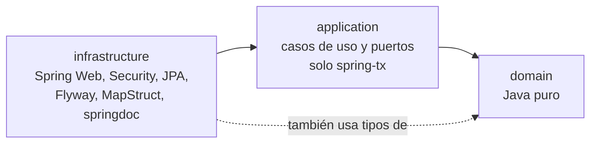

Una forma práctica de recordarlo son círculos concéntricos:

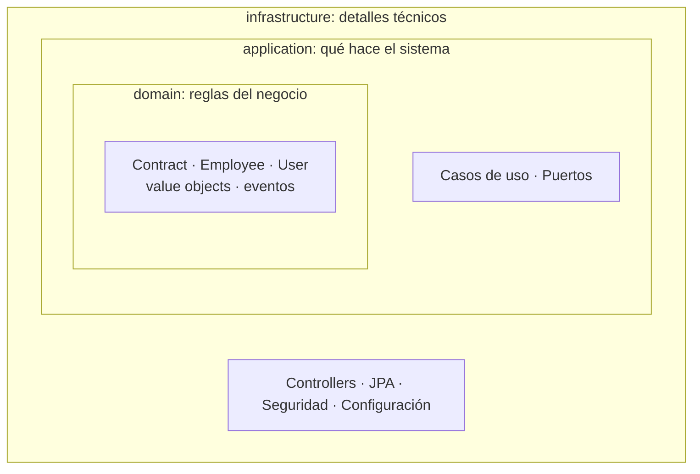

| Módulo | Responsabilidad | Puede usar | Nunca usa |
|---|---|---|---|
| `domain` | Invariantes, estados y eventos del negocio | JDK | Spring, JPA, Jackson, Lombok |
| `application` | Orquestar una operación: cargar, delegar al dominio, persistir | `domain`, `@Transactional` | Controllers, entidades JPA, `@Service` |
| `infrastructure` | Traducir entre el mundo exterior y el núcleo | Todo | — |

**Por qué importa:** las reglas de negocio se prueban sin levantar Spring ni una base de datos, y cambiar una tecnología (por ejemplo, el emisor de tokens) no toca la lógica.

Dentro de `domain` los paquetes se organizan por agregado (ADR-0004):

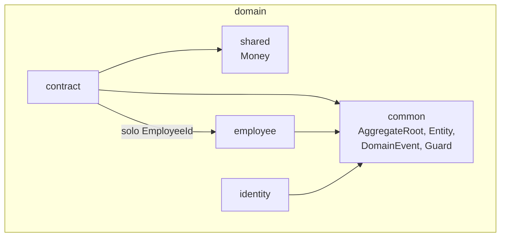

## 4. Puertos y adaptadores

`application` define **puertos**: interfaces que describen lo que el núcleo ofrece (entrada) y lo que necesita (salida). `infrastructure` los conecta con tecnología concreta mediante **adaptadores**.

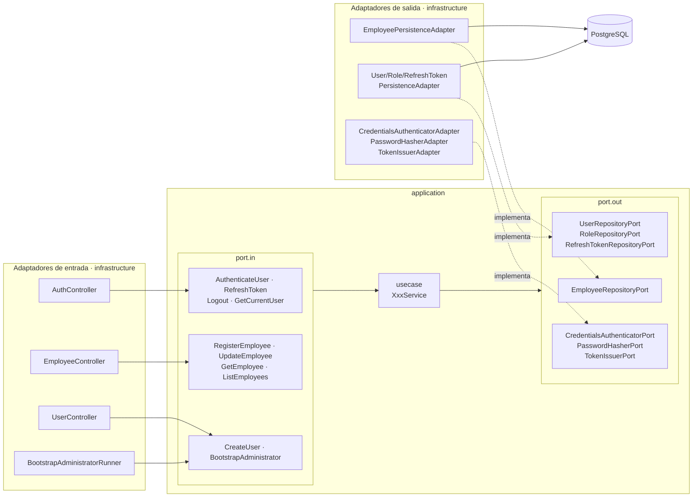

Dos ideas clave:

- **El núcleo define el contrato, la infraestructura se adapta.** `TokenIssuerPort` no menciona JWT ni Nimbus; `TokenIssuerAdapter` sí. Si mañana se cambiara la librería de firmas, solo cambia el adaptador.
- **No todos los puertos de salida son repositorios.** Autenticar credenciales, hashear contraseñas o emitir tokens también son capacidades técnicas que el caso de uso pide a través de un puerto.

Dentro de `infrastructure` también hay aislamiento (regla 9): `api` solo llama a puertos de entrada y nunca a `persistence`; `persistence` no conoce `api`.

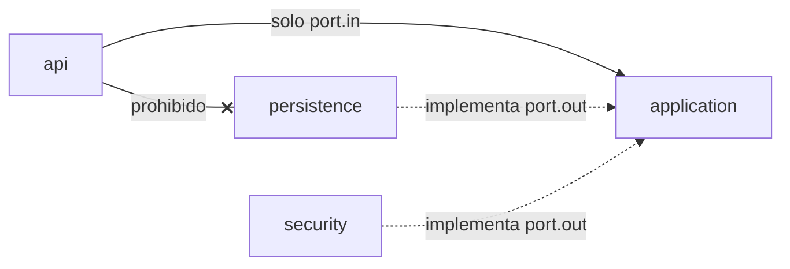

## 5. Cómo se ensambla: casos de uso como beans

Los servicios de `application` no llevan `@Service`: son clases Java normales. `UseCaseConfig` los crea y Spring inyecta los adaptadores que implementan cada puerto.

```mermaid
flowchart LR
    CFG[UseCaseConfig<br/>@Configuration] -->|new RegisterEmployeeService| UC[RegisterEmployeeUseCase<br/>bean]
    ADP[EmployeePersistenceAdapter<br/>@Component] -->|se inyecta como<br/>EmployeeRepositoryPort| CFG
    UC -->|se inyecta en| CTRL[EmployeeController]
```

```java
@Bean
RegisterEmployeeUseCase registerEmployeeUseCase(EmployeeRepositoryPort employeeRepository) {
    return new RegisterEmployeeService(employeeRepository);
}
```

El controller recibe la **interfaz** `RegisterEmployeeUseCase`, no la clase del servicio. Así `api` depende de un contrato y las pruebas `@WebMvcTest` pueden simular el caso de uso.

## 6. Modelo de dominio

### 6.1 Bloques comunes

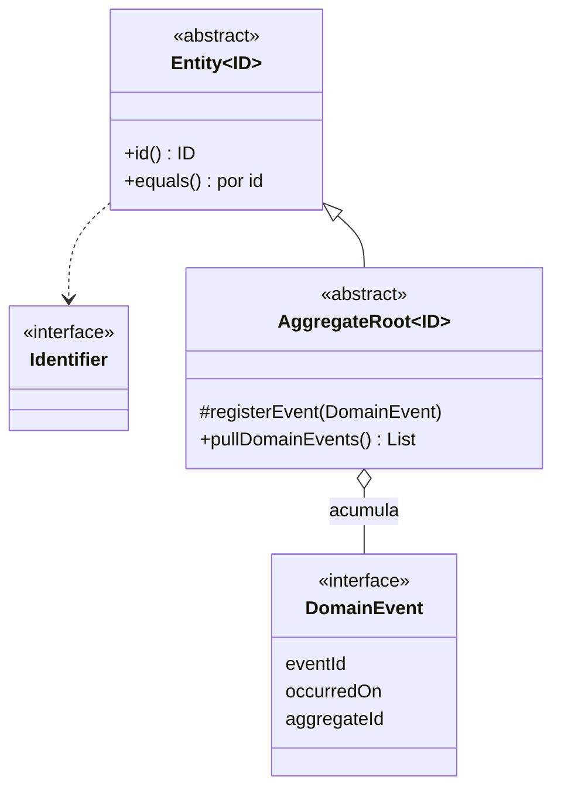

- Una **entidad** se compara por su identificador; un **value object** (`record`) por su valor.
- Un **agregado** es la unidad de consistencia: se carga, se modifica y se guarda completo, y solo su raíz es accesible desde fuera.
- Los métodos que emiten eventos reciben un `Clock`: el dominio nunca llama a `now()`, lo que hace las pruebas deterministas.

### 6.2 Agregados

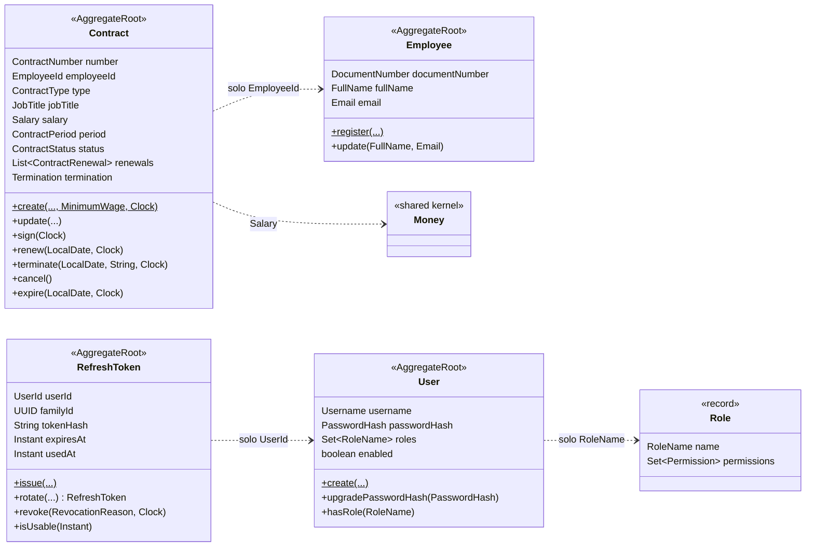

Los agregados se referencian entre sí **solo por identificador** (`Contract` guarda un `EmployeeId`, nunca un `Employee`). Comprobar que el empleado existe es tarea del caso de uso (BR-CTR-001), no del agregado.

### 6.3 Dónde vive cada regla

| Tipo de regla | Dónde | Ejemplo |
|---|---|---|
| Formato de un valor | Constructor del value object | DNI de 8 dígitos (`DocumentNumber`, BR-EMP-002) |
| Invariante de un agregado | Método del agregado | Solo se modifica un contrato en `DRAFT` (`Contract.update`, BR-CTR-006) |
| Regla que necesita otros datos | Caso de uso | Documento único (`RegisterEmployeeService`, BR-EMP-001) |
| Formato de la petición HTTP | Bean Validation en el `Request` | `email` obligatorio y ≤ 254 caracteres |
| Permisos | Seguridad (`infrastructure`) | `/api/v1/users` exige `user:manage` |

## 7. Recorrido de una petición

`POST /api/v1/employees` atraviesa todas las capas:

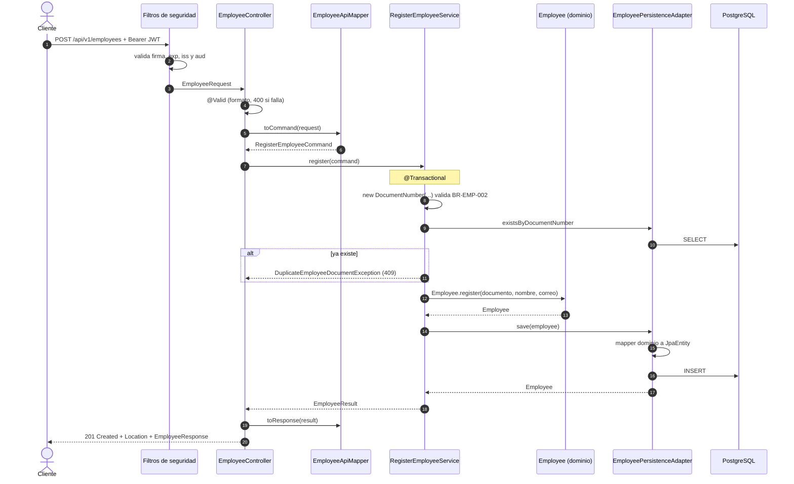

Fíjate en las **cuatro representaciones** del mismo empleado, cada una en su capa:

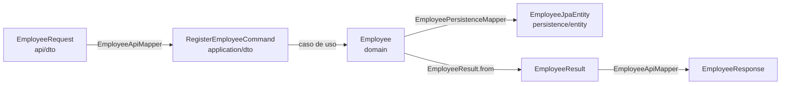

Separarlas evita que un cambio en la tabla o en el JSON obligue a tocar el dominio.

**Concurrencia:** si dos peticiones registran el mismo documento a la vez, ambas pasan el `exists`, pero la restricción única `uk_employees_document` rechaza la segunda. El adaptador traduce esa `DataIntegrityViolationException` en `DuplicateEmployeeDocumentException`, así el cliente recibe igualmente `409`.

## 8. Autenticación y tokens

### 8.1 Cadenas de filtros

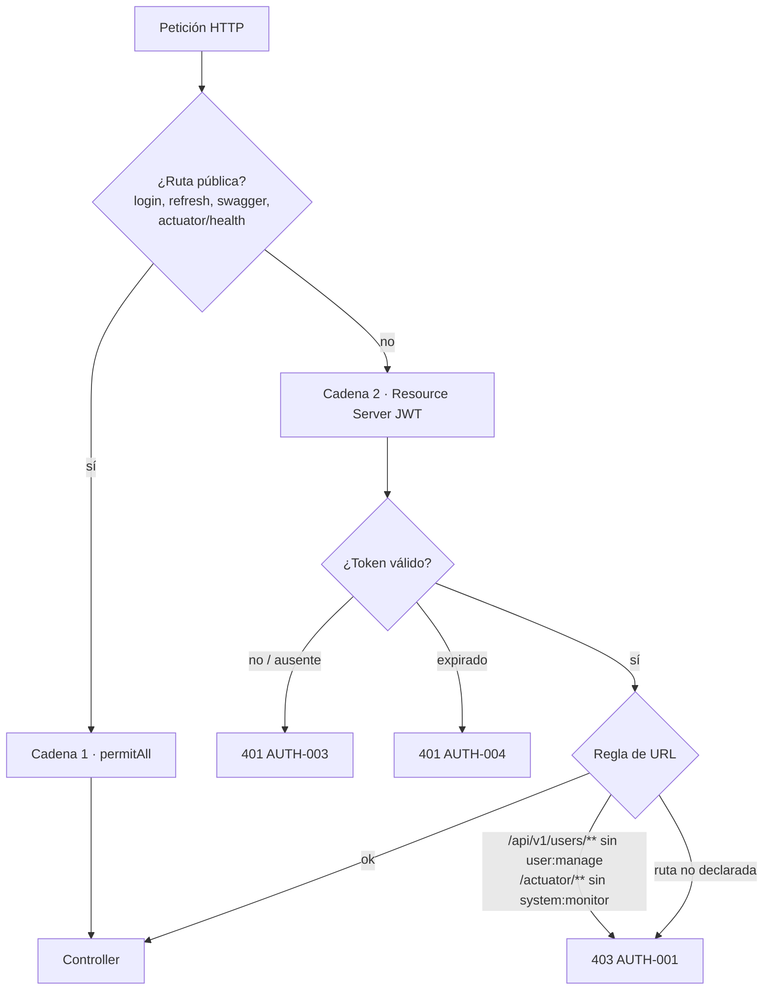

Ambas cadenas son *stateless*: no hay sesión ni CSRF, todo viaja en la cabecera `Authorization`. El claim `perms` del JWT se convierte en las authorities que evalúa Spring Security.

### 8.2 Login

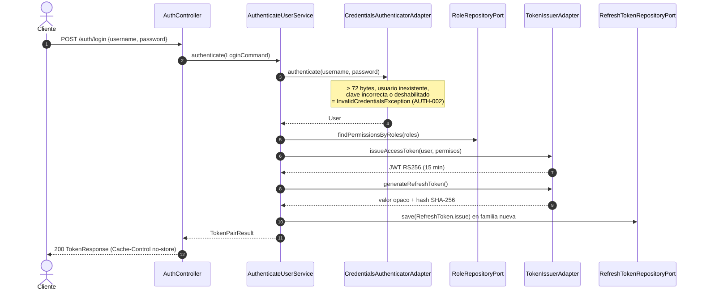

Solo el **hash** del refresh token se guarda en base de datos; el valor en claro solo lo tiene el cliente.

### 8.3 Rotación del refresh token

Cada refresh token es de un solo uso (BR-USR-006). Al usarlo nace otro de la **misma familia**; si alguien presenta uno ya usado, se asume robo y se revoca la familia completa.

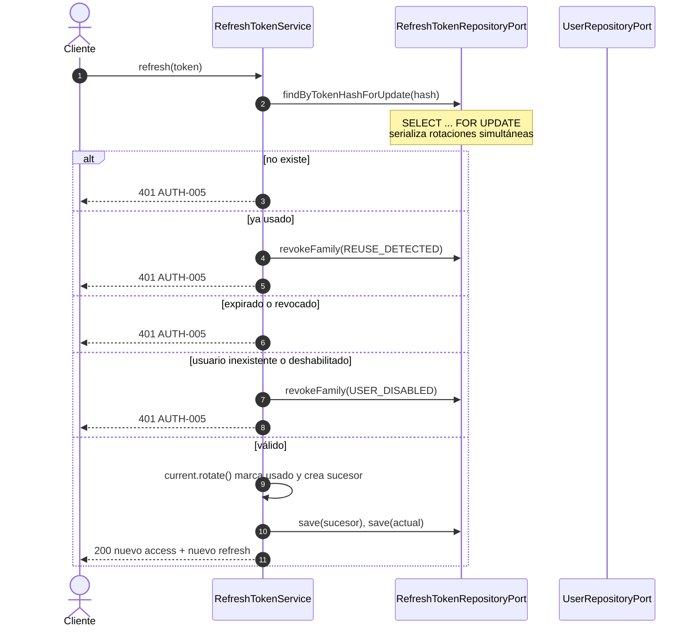

La transacción usa `noRollbackFor = InvalidRefreshTokenException`: la revocación de la familia se confirma aunque la respuesta sea un error.

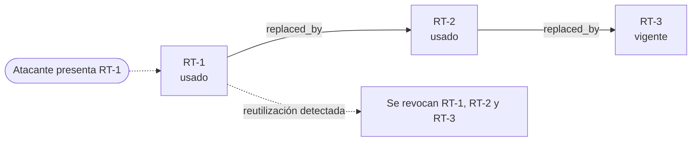

## 9. Manejo de errores

Cada capa lanza su propio tipo de excepción y **solo** `infrastructure` las traduce a HTTP, siempre en formato RFC 9457 (Problem Details).

```mermaid
flowchart TB
    subgraph domain
        DE[DomainException<br/>InvalidValueException VAL-001<br/>InvalidDocumentNumberException EMP-002<br/>CTR-001 ... CTR-008]
    end
    subgraph application
        NF[NotFoundException<br/>EMP-404, AUTH-404, AUTH-009]
        CF[ConflictException<br/>EMP-001, AUTH-007]
        UA[UnauthenticatedException<br/>AUTH-002]
    end
    subgraph infrastructure
        GEH[GlobalExceptionHandler<br/>@RestControllerAdvice]
        SEC[ProblemDetailsAuthenticationEntryPoint<br/>ProblemDetailsAccessDeniedHandler]
    end
    DE --> GEH
    NF --> GEH
    CF --> GEH
    UA --> GEH
    GEH --> PD[application/problem+json<br/>type, title, status, detail, code]
    SEC --> PD
```

| Origen | HTTP |
|---|---|
| `@Valid` en el controller | `400` con `errors[]` |
| `DomainException` | `422` (salvo `CTR-008` → `409` y `AUTH-005` → `401`) |
| `NotFoundException` | `404` |
| `ConflictException` | `409` |
| `UnauthenticatedException` | `401` |
| Filtros de seguridad | `401` (AUTH-003/004) o `403` (AUTH-001) |
| Cualquier otra | `500` sin detalles internos |

La tabla completa de códigos está en [business-rules.md §8](../business-rules.md#8-catálogo-de-errores-de-negocio).

## 10. Ciclos de vida

### 10.1 Contrato

Implementado y probado en `domain`; aún sin casos de uso ni endpoints.

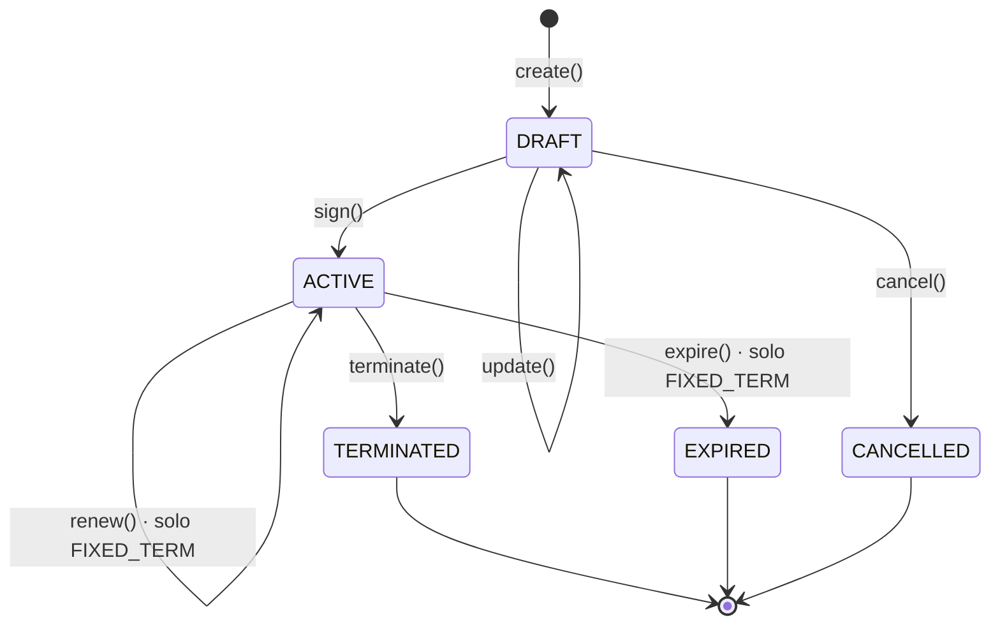

Cada transición registra un evento (`ContractCreated`, `ContractSigned`, `ContractRenewed`, `ContractTerminated`, `ContractExpired`), que forman la interfaz *sealed* `ContractEvent`. Hoy nadie los publica fuera del agregado (business-rules §9).

### 10.2 Refresh token

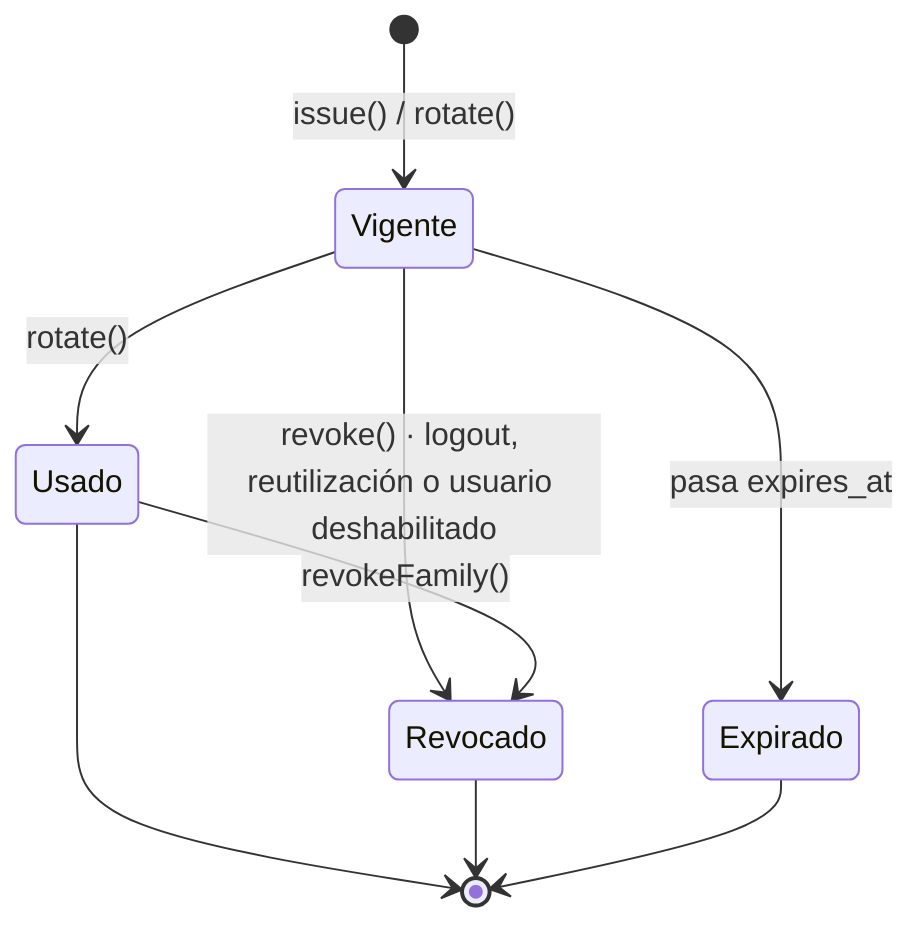

## 11. Pruebas por capa

```mermaid
flowchart TB
    E2E[Extremo a extremo<br/>AuthenticationFlowIntegrationTest<br/>BootstrapAdministratorIntegrationTest]
    INT[Integración · Testcontainers PostgreSQL<br/>adaptadores de persistencia, seguridad]
    SLICE[Slice web · @WebMvcTest<br/>Auth, Employee y UserController]
    APPT[Unitarias de application · Mockito sobre port.out]
    DOMT[Unitarias de domain · JUnit + AssertJ, sin mocks]
    E2E --- INT --- SLICE --- APPT --- DOMT
```

Cuanto más abajo, más pruebas, más rápidas y más reglas de negocio cubren. `./mvnw clean verify` exige ≥ 80 % de cobertura de líneas en `domain` y `application`.

## 12. Cómo añadir una funcionalidad

El orden de [CLAUDE.md](../../CLAUDE.md) va del centro hacia fuera. Ejemplo con `SignContractUseCase`, todavía pendiente:

```mermaid
flowchart LR
    A[1 · Dominio<br/>Contract.sign ya existe] --> B[2 · port.in<br/>SignContractUseCase]
    B --> C[3 · usecase<br/>SignContractService<br/>+ BR-CTR-005]
    C --> D[4 · port.out<br/>ContractRepositoryPort]
    D --> E[5 · Adaptador<br/>ContractPersistenceAdapter<br/>+ migración V5]
    E --> F[6 · Controller<br/>POST /contracts/id/sign]
    F --> G[7 · Pruebas<br/>de cada capa]
    C -.->|registrar bean| CFG[UseCaseConfig]
```

Lista de comprobación:

- [ ] ¿La regla está en [business-rules.md](../business-rules.md)? Si no, se pregunta antes de implementar.
- [ ] ¿Cada clase está en el módulo y paquete correctos (§3)?
- [ ] ¿El caso de uso está registrado en `UseCaseConfig` y no tiene `@Service`?
- [ ] ¿El controller solo usa el puerto de entrada y DTOs de `api/dto`?
- [ ] ¿Las nuevas excepciones tienen código en el catálogo y su traducción HTTP?
- [ ] ¿`./mvnw clean verify` pasa?

## 13. Observaciones

Diferencias entre el código actual y lo documentado en [architecture.md](../architecture.md) y [business-rules.md](../business-rules.md):

- **`Employee` sin estado:** el agregado aún no tiene `EmployeeStatus` ni los métodos de desactivar/reactivar (BR-EMP-005–008).
- **`Contract` sin persistencia:** el agregado está completo en `domain`, pero no hay `ContractRepositoryPort`, tabla ni endpoints.
- **Regla 9 (aislamiento en `infrastructure`):** verificada por búsqueda; `api` no importa de `persistence` ni `client`, y `persistence` y `security` no importan de `api`.
