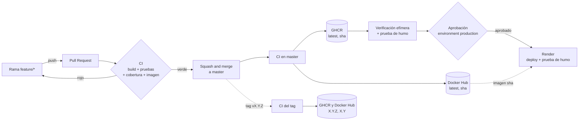

# Guía de CI/CD de contract-api

Guía práctica para trabajar con el flujo de integración y entrega continua del proyecto: cómo se integra un cambio en `master`, qué valida el pipeline, dónde se publica la imagen Docker y cómo ejecutarla. Las decisiones y sus motivos están en [ADR-0009](../adr/0009-ci-cd-github-actions.md) (GitHub Actions), [ADR-0012](../adr/0012-github-flow-y-despliegue-con-aprobacion.md) (GitHub Flow y despliegue con aprobación), [ADR-0013](../adr/0013-despliegue-en-render.md) (despliegue en Render) y [ADR-0010](../adr/0010-jenkins-local-de-practica.md) (Jenkins local).

## Índice

1. [Visión general](#1-visión-general)
2. [Requisitos](#2-requisitos)
3. [Flujo de trabajo con GitHub Flow](#3-flujo-de-trabajo-con-github-flow)
4. [Protección de `master` (ruleset)](#4-protección-de-master-ruleset)
5. [El pipeline de GitHub Actions](#5-el-pipeline-de-github-actions)
6. [Publicar una versión](#6-publicar-una-versión)
7. [Registros de imágenes: GHCR y Docker Hub](#7-registros-de-imágenes-ghcr-y-docker-hub)
8. [Ejecutar la imagen publicada](#8-ejecutar-la-imagen-publicada)
9. [Manejo de secretos](#9-manejo-de-secretos)
10. [Jenkins local](#10-jenkins-local)
11. [Problemas frecuentes](#11-problemas-frecuentes)

## 1. Visión general



| Evento | Build y pruebas | Imagen | Publicación | Despliegue |
|---|:-:|:-:|---|---|
| Pull Request a `master` | ✅ | se construye | ninguna | — |
| Push a `master` (merge) | ✅ | se construye | `latest` y sha corto | verificación efímera; Render tras aprobar `production` |
| Tag `vX.Y.Z` | ✅ | se construye | `X.Y.Z` y `X.Y` | — |
| Manual (*Run workflow*) | ✅ | se construye | según la rama elegida | — |

## 2. Requisitos

- Git y una cuenta de GitHub con acceso al repositorio.
- Docker Desktop (contenedores Linux) para ejecutar la imagen, las pruebas con Testcontainers y Jenkins.
- JDK 21 solo si compilas en local (`./mvnw` descarga Maven).
- Git Bash o PowerShell. Los comandos indican en cuál se ejecutan cuando la sintaxis difiere.

## 3. Flujo de trabajo con GitHub Flow

`master` siempre es desplegable y **nunca recibe commits directos** ([ADR-0012](../adr/0012-github-flow-y-despliegue-con-aprobacion.md)). Todo cambio entra por Pull Request.

### 3.1 Crear la rama

```bash
git checkout master
git pull
git checkout -b feature/mi-cambio        # o fix/<tema>, docs/<tema>
```

### 3.2 Trabajar y verificar en local

```bash
./mvnw clean verify      # lo mismo que ejecuta el CI, incluido el umbral de cobertura
```

Los mensajes de commit van en español, en imperativo y explican el porqué:

```bash
git add <archivos>
git commit -m "Validar el formato del correo al registrar empleados"
git push -u origin feature/mi-cambio
```

### 3.3 Abrir el Pull Request

1. GitHub muestra **Compare & pull request** tras el push; también puedes usar `gh pr create`.
2. Completa la plantilla: en **Qué cambia** describe el cambio y su motivo, y marca la checklist.
3. Espera los dos checks: **Build, pruebas y cobertura** e **Imagen Docker**.

### 3.4 Integrar

- Si GitHub indica **This branch is out-of-date with the base branch**, pulsa **Update branch** y espera de nuevo el CI.
- Con los checks en verde, revisa el diff y pulsa **Squash and merge** → **Confirm**. Es el único método permitido: cada PR queda como un solo commit en `master`.
- Borra la rama (**Delete branch**) y actualiza tu copia local:

```bash
git checkout master
git pull
git branch -D feature/mi-cambio      # -D porque con squash git no reconoce la rama como integrada
```

### 3.5 Aprobar el despliegue

El merge dispara el CI en `master`. Cuando la imagen se publica y pasa la **Verificación de la imagen** (sección 5.3), el job **Despliegue (production)** queda en *Waiting*:

1. Abre la ejecución en *Actions → CI/CD* y revisa en el **Summary** la tabla *Imagen verificada (entorno efímero)*.
2. Pulsa **Review deployments**, marca `production`, añade un comentario si quieres y pulsa **Approve and deploy**. El banner amarillo desaparece y el job pasa a *In progress*; si sigue en *Waiting*, la aprobación no se registró. Con **Reject** no se despliega y Render sigue con la versión anterior.
3. Al terminar, la tabla *Despliegue verificado en Render (production)* muestra la URL, la imagen (`sha-<corto>`) y cada comprobación (sección 5.4). El enlace del environment en la ejecución abre la API.

El historial de aprobaciones, con quién aprobó y cuándo, queda en *Code → Deployments*.

## 4. Protección de `master` (ruleset)

La regla `master-protegida` está versionada en [`.github/ruleset/master-protegida.json`](../../.github/ruleset/master-protegida.json) y se aplica a la rama por defecto:

| Regla | Efecto |
|---|---|
| Pull Request obligatorio | No se puede hacer push directo a `master`. Sin aprobaciones mínimas: GitHub no permite que un único desarrollador apruebe su propio PR. |
| Solo *squash* | Un commit por PR en `master`. |
| Checks requeridos | `Build, pruebas y cobertura` e `Imagen Docker` deben estar en verde. |
| Rama al día | La rama debe incluir los últimos cambios de `master` antes de integrarse. |
| Sin force push ni borrado | Protege el historial de `master`. |

**Configurarla en un repositorio nuevo o en tu fork:** *Settings → Rules → Rulesets → New ruleset → Import a ruleset* y selecciona el JSON. Los checks requeridos solo aparecen en el buscador después de que el workflow se haya ejecutado una vez.

> En un repositorio **privado** con plan Free, GitHub permite crear la regla pero **no la aplica** (aparece con un ícono amarillo). Hace falta que el repositorio sea público o un plan Pro/Team. Con la regla activa el ícono es verde.

Si cambias el JSON, hay que volver a importarlo a mano en GitHub: el archivo es la referencia, no se aplica solo.

### 4.1 Environment `production`

El job de despliegue usa el environment `production` (*Settings → Environments*):

1. **New environment** → nombre `production`.
2. Marca **Required reviewers** y añade tu usuario. Con un único desarrollador, deja desmarcado *Prevent self-review*.
3. En **Deployment branches and tags** elige *Selected branches and tags* y añade `master`.
4. En **Environment secrets** añade `RENDER_API_KEY` y `SMOKE_ADMIN_PASSWORD` (sección 5.4). Al ser secretos del environment, solo los lee el job aprobado.

Si el environment no existe, GitHub lo crea al primer despliegue **sin revisores**, y el job se ejecuta sin esperar aprobación.

## 5. El pipeline de GitHub Actions

Definido en [`.github/workflows/ci-cd.yml`](../../.github/workflows/ci-cd.yml). Tiene cuatro jobs encadenados y cada uno solo empieza si el anterior termina bien. Los dos últimos solo se ejecutan tras un push a `master`, y el cuarto además necesita la aprobación. El análisis de SonarCloud es un paso del primero ([ADR-0011](../adr/0011-analisis-estatico-sonarcloud.md)).

### 5.1 Job `Build, pruebas y cobertura`

- Ejecuta `./mvnw -B -ntp clean verify` con JDK 21 (Temurin) y caché de Maven.
- Incluye las pruebas de integración con **Testcontainers** (PostgreSQL real; el runner `ubuntu-latest` ya tiene Docker).
- **JaCoCo** exige al menos un **80 % de líneas cubiertas** en `domain` y `application`; si no se alcanza, el build falla. `infrastructure` solo genera el informe.
- Al terminar, aunque falle:
  - escribe una tabla de cobertura por módulo en el **resumen** de la ejecución (*Actions → ejecución → Summary*);
  - publica el artefacto **reports** (informes de Surefire y JaCoCo, 14 días). Descárgalo desde la ejecución y abre `*/target/site/jacoco/index.html`.
- Si el repositorio tiene el secreto `SONAR_TOKEN`, ejecuta el **análisis de SonarCloud** con la cobertura de JaCoCo y espera el **Quality Gate**: si no se cumple, el job falla (sección 5.6). Sin el secreto, el paso se omite.

### 5.2 Job `Imagen Docker`

- Construye la imagen con el [`Dockerfile`](../../Dockerfile) multi-stage: compila con el Maven Wrapper (sin pruebas, ya se ejecutaron), extrae las capas de Spring Boot y genera una imagen con JRE 21, usuario sin privilegios y perfil `prod`.
- En un push a `master` y en tags la construye y la publica (sección 7). En un PR solo la construye.
- Usa la caché de GitHub Actions para las capas, así que las ejecuciones siguientes son más rápidas.

### 5.3 Job `Verificación de la imagen`

Automático tras un push a `master`, sin aprobación. Prueba la imagen recién publicada en un **entorno efímero** del runner, antes de pedir la aprobación:

- Levanta PostgreSQL 16 como servicio del job.
- Genera en el momento las claves JWT y la contraseña del administrador inicial. No hay secretos que configurar y no sobreviven al job.
- Descarga de GHCR la imagen **por su sha** (`sha-<corto>`, no `latest`) y la arranca con el perfil `prod`.
- Ejecuta la **prueba de humo** ([`.github/scripts/smoke-test.sh`](../../.github/scripts/smoke-test.sh)):
  - espera hasta 120 s a que `/actuator/health` responda `UP` (Flyway migró la base y la aplicación arrancó);
  - login del administrador inicial (BR-USR-007);
  - `GET /api/v1/auth/me` y `GET /api/v1/employees` con el token deben dar `200`;
  - `GET /api/v1/employees` sin token debe dar `401`.
- Escribe la tabla *Imagen verificada* en el resumen, muestra los logs del contenedor y retira el entorno, aunque algo falle.

### 5.4 Job `Despliegue (production)` en Render

Solo tras la verificación y con la aprobación del environment `production` (secciones 3.5 y 4.1). Despliega en [Render](https://render.com) (plan gratuito) la imagen de **Docker Hub** con el mismo sha, que es pública y Render descarga sin credenciales ([ADR-0013](../adr/0013-despliegue-en-render.md)):

1. [`.github/scripts/render-deploy.sh`](../../.github/scripts/render-deploy.sh) llama a la API de Render (`POST /v1/services/{id}/deploys` con `imageUrl`) y consulta el deploy cada 10 s hasta `live`. Falla si Render lo marca como fallido o cancelado, o si tarda más de 15 min.
2. La misma prueba de humo se ejecuta contra la URL pública, con hasta 300 s para el health: el plan gratuito duerme el servicio tras 15 min sin tráfico.

Si el repositorio no define la variable `RENDER_SERVICE_ID` (por ejemplo, en un fork), el job se omite.

**Configurar Render (una sola vez):**

1. Genera las claves JWT de production en Git Bash. Cada PEM debe quedar en una sola línea con `\n` literales (como en la sección 8.2):

   ```bash
   openssl genpkey -algorithm RSA -pkeyopt rsa_keygen_bits:2048 -out private.pem
   openssl pkey -in private.pem -pubout -out public.pem
   awk '{printf "%s\\n", $0}' public.pem  > public.line    # valor de SECURITY_JWT_PUBLIC_KEY
   awk '{printf "%s\\n", $0}' private.pem > private.line   # valor de SECURITY_JWT_PRIVATE_KEY
   ```

   Elige también la contraseña del administrador; debe cumplir BR-USR-003 o la aplicación no arranca. Al terminar, borra los archivos: el valor vive en Render.
2. En Render, crea la cuenta y entra en **New → Blueprint**. Conecta el repositorio y Render lee [`render.yaml`](../../render.yaml). Crea el servicio `contract-api` y la base `contract-db`, y pide los valores marcados con `sync: false`:
   - `SECURITY_JWT_PUBLIC_KEY` y `SECURITY_JWT_PRIVATE_KEY`: el contenido de `public.line` y `private.line`;
   - `SECURITY_BOOTSTRAP_ADMIN_PASSWORD`: la contraseña del administrador;
   - `DB_URL`: déjalo en blanco por ahora.
3. Abre `contract-db` → **Connections**, copia el *Hostname* interno (`dpg-…-a`) y define en `contract-api` → **Environment** `DB_URL=jdbc:postgresql://<hostname>:5432/contracts`. Guarda y despliega: en **Logs** deben aparecer las migraciones de Flyway y `Started ContractApiApplication`.
4. En Render, **Account Settings → API Keys → Create API Key**. Copia también el id del servicio (`srv-…`, visible en la URL del panel) y su URL pública (`https://contract-api-xxxx.onrender.com`).
5. En GitHub (Git Bash o PowerShell, con `gh` autenticado), los secretos se piden por teclado y no quedan en el historial:

   ```bash
   gh secret set RENDER_API_KEY --env production
   gh secret set SMOKE_ADMIN_PASSWORD --env production   # la misma contraseña del administrador
   gh variable set RENDER_SERVICE_ID --body "srv-..."
   gh variable set RENDER_URL --body "https://contract-api-xxxx.onrender.com"
   ```

6. El siguiente merge a `master` despliega en Render tras la aprobación. Para desplegar sin un commit nuevo, abre la última ejecución de `master` y pulsa **Re-run all jobs**.

> El plan gratuito tiene límites: el servicio duerme tras 15 min sin tráfico (la primera petición tarda alrededor de un minuto), 512 MB de memoria y una base PostgreSQL que **caduca a los 30 días**. Render avisa antes de borrarla.

### 5.5 Ejecutar el pipeline a mano

*Actions → CI/CD → Run workflow* y elige la rama. Útil, por ejemplo, después de configurar un secreto sin tener que hacer un commit.

### 5.6 Configurar SonarCloud (una sola vez)

1. Entra a <https://sonarcloud.io> con tu cuenta de GitHub → **+ → Analyze new project** → elige el repositorio (gratis para repositorios públicos).
2. En el proyecto: *Administration → Analysis Method* → desactiva **Automatic Analysis** (si está activo, el análisis desde el CI falla).
3. *My Account → Security* → genera un token.
4. En GitHub: *Settings → Secrets and variables → Actions → Secrets* → `SONAR_TOKEN` = el token.
5. Solo si tu organización o clave de proyecto en SonarCloud son distintas de las de GitHub, crea en la pestaña **Variables** `SONAR_ORGANIZATION` y/o `SONAR_PROJECT_KEY`. Por defecto se usan `<dueño>` y `<dueño>_<repositorio>` (p. ej. `christophersanz` y `christophersanz_AI-CICD`), que son los que crea SonarCloud al importar.
6. *Run workflow* sobre `master` y revisa el resultado en el panel del proyecto en SonarCloud. Ese panel es la evidencia de **"Análisis estático sin issues críticos"**.

## 6. Publicar una versión

Las versiones siguen [SemVer](https://semver.org/lang/es/) y se crean con un tag sobre `master`:

```bash
git checkout master
git pull
git tag v0.2.0
git push origin v0.2.0
```

El pipeline publica la imagen con las etiquetas `0.2.0` y `0.2`. `latest` no cambia con un tag: solo avanza con los push a `master`.

Opcional: *Releases → Draft a new release*, elige el tag, pulsa **Generate release notes** y **Publish release**.

## 7. Registros de imágenes: GHCR y Docker Hub

La misma imagen y las mismas etiquetas se publican en dos registros:

| | GHCR | Docker Hub |
|---|---|---|
| Imagen | `ghcr.io/christophersanz/ai-cicd` | `docker.io/<usuario-dockerhub>/ai-cicd` |
| Visibilidad | Privada por defecto (se puede hacer pública en *Packages → Package settings*) | Pública |
| Para descargar | `docker login ghcr.io` con un token | Sin login |
| Credenciales en el pipeline | `GITHUB_TOKEN`, automático | Variable `DOCKERHUB_USERNAME` y secreto `DOCKERHUB_TOKEN` |

### 7.1 Descargar desde Docker Hub (recomendado)

```bash
docker pull <usuario-dockerhub>/ai-cicd:latest
docker pull <usuario-dockerhub>/ai-cicd:0.1.0
```

Docker Hub limita las descargas anónimas por IP. Si un aula entera comparte IP y alcanza el límite, inicia sesión con `docker login` (cuenta gratuita) para tener un límite mayor.

### 7.2 Descargar desde GHCR

1. Crea un token **classic** (empieza por `ghp_`) con solo el permiso `read:packages`: <https://github.com/settings/tokens/new?scopes=read:packages&description=ghcr-read>. Los tokens *fine-grained* no sirven para GHCR.
2. (Solo si el repositorio pertenece a una organización con SSO) autoriza el token con **Configure SSO**.
3. Inicia sesión **sin escribir el token en el comando** (PowerShell):

```powershell
$t = Read-Host "Token"                     # pega el token cuando aparezca "Token:"
$t | docker login ghcr.io -u <tu-usuario-github> --password-stdin
Remove-Variable t
```

4. `docker pull ghcr.io/christophersanz/ai-cicd:latest`

### 7.3 Configurar Docker Hub en tu propio repositorio o fork

Sin esta configuración el pipeline publica solo en GHCR y no falla.

1. En Docker Hub: crea el repositorio `ai-cicd` como **Public** y un token en *Account settings → Personal access tokens* con permiso **Read & Write**.
2. En GitHub: *Settings → Secrets and variables → Actions*:
   - pestaña **Variables** → *New repository variable*: `DOCKERHUB_USERNAME` = tu usuario de Docker Hub;
   - pestaña **Secrets** → *New repository secret*: `DOCKERHUB_TOKEN` = el token.
3. Ejecuta el pipeline (*Run workflow* sobre `master`) y comprueba que el paso **Login en Docker Hub** está en verde, no *skipped*.

> El usuario va como **variable** y no como secreto a propósito: forma parte del nombre de la imagen, y los secretos se enmascaran como `***` en los logs.

## 8. Ejecutar la imagen publicada

La imagen arranca con el perfil `prod`: **no tiene valores por defecto ni genera claves**. Necesita la base de datos y un par de claves RSA para firmar los JWT; si falta algo, no arranca. Swagger está desactivado.

### 8.1 Base de datos

Usa el PostgreSQL del proyecto:

```bash
docker compose up -d        # desde la raíz del repositorio: PostgreSQL (5432) y pgAdmin (5050)
```

### 8.2 Generar las claves y el archivo de variables (Git Bash)

Créalos **fuera del repositorio**:

```bash
mkdir -p ~/contract-api-prod && cd ~/contract-api-prod

openssl genpkey -algorithm RSA -pkeyopt rsa_keygen_bits:2048 -out private.pem
openssl pkey -in private.pem -pubout -out public.pem

# Cada PEM en una sola línea con \n literales (la API los admite así)
PUB=$(awk '{printf "%s\\n", $0}' public.pem)
PRIV=$(awk '{printf "%s\\n", $0}' private.pem)

cat > prod.env <<EOF
DB_URL=jdbc:postgresql://host.docker.internal:5432/contracts
DB_USERNAME=contract
DB_PASSWORD=contract
SECURITY_JWT_PUBLIC_KEY=$PUB
SECURITY_JWT_PRIVATE_KEY=$PRIV
SECURITY_BOOTSTRAP_ADMIN_USERNAME=admin
SECURITY_BOOTSTRAP_ADMIN_PASSWORD=<elige-una-contraseña-de-12-o-más>
EOF
```

- `host.docker.internal` permite al contenedor llegar al PostgreSQL publicado en tu máquina.
- La contraseña del administrador debe tener entre 12 y 64 caracteres (BR-USR-003).
- El administrador inicial solo se crea si **no existe ningún usuario `ADMIN`** en la base (BR-USR-007). Si ya probaste la API en local con esa base, usa las credenciales que creaste entonces.

### 8.3 Ejecutar el contenedor

Git Bash:

```bash
docker run -d --name contract-api-prod -p 8081:8081 \
  --env-file ~/contract-api-prod/prod.env \
  <usuario-dockerhub>/ai-cicd:latest

docker logs -f contract-api-prod      # espera "Started ContractApiApplication"; sal con Ctrl+C
```

PowerShell (la continuación de línea es el acento grave y `~` no se expande para programas externos):

```powershell
docker run -d --name contract-api-prod -p 8081:8081 `
  --env-file "$HOME\contract-api-prod\prod.env" `
  <usuario-dockerhub>/ai-cicd:latest
```

Si el puerto 8081 está ocupado (por ejemplo, por la API en `spring-boot:run`), usa `-p 8082:8081` y llama al 8082.

### 8.4 Probar la API (PowerShell)

```powershell
$pwd = Read-Host "Contraseña de admin" -AsSecureString
$plain = [Net.NetworkCredential]::new('', $pwd).Password
$body = @{ username = 'admin'; password = $plain } | ConvertTo-Json

$login = Invoke-RestMethod -Method Post -Uri http://localhost:8081/api/v1/auth/login `
  -ContentType 'application/json' -Body $body
$h = @{ Authorization = "Bearer $($login.accessToken)" }

Invoke-RestMethod http://localhost:8081/api/v1/auth/me -Headers $h            # usuario actual
Invoke-RestMethod http://localhost:8081/actuator/health -Headers $h           # status UP (requiere system:monitor)
Invoke-RestMethod "http://localhost:8081/api/v1/employees?page=0&size=5" -Headers $h
```

Un `401` con código `AUTH-002` en el login significa usuario o contraseña incorrectos.

### 8.5 Limpiar

```bash
docker rm -f contract-api-prod
```

## 9. Manejo de secretos

`private.pem` firma todos los tokens de acceso: quien la tenga puede emitir tokens válidos.

**Nunca:**

- versionar claves, `.env` ni tokens: `.gitignore` y `.dockerignore` ya ignoran `*.pem`, `*.key` y `*.env` como red de seguridad;
- escribir un token dentro de un comando o pegarlo en un chat, captura o ticket: queda en el historial de la terminal y en el destino. Si ocurre, **revócalo y crea otro**;
- reutilizar las contraseñas por defecto del entorno local (`contract`, `admin`) en un servidor.

**Variables de entorno frente a archivos.** Con `--env-file`, las claves quedan como variables de entorno y cualquiera con acceso a Docker las ve con `docker inspect <contenedor>`. Es más seguro montarlas como archivos con `secrets` de Docker Compose y que Spring Boot las lea con `configtree` (cada archivo de la carpeta se convierte en la propiedad de su nombre). No requiere cambios en el código:

```yaml
# ~/contract-api-prod/docker-compose.yml
services:
  api:
    image: <usuario-dockerhub>/ai-cicd:latest
    ports: ["8081:8081"]
    environment:
      SPRING_CONFIG_IMPORT: "optional:configtree:/run/secrets/"
      DB_URL: jdbc:postgresql://host.docker.internal:5432/contracts
      DB_USERNAME: contract
    secrets:
      - source: jwt_private
        target: security.jwt.private-key
      - source: jwt_public
        target: security.jwt.public-key
      - source: db_password
        target: spring.datasource.password
secrets:
  jwt_private: { file: ./private.pem }
  jwt_public:  { file: ./public.pem }
  db_password: { file: ./db_password.txt }
```

`db_password.txt` contiene solo la contraseña, sin salto de línea final (PowerShell: `Set-Content -NoNewline -Encoding ascii db_password.txt contract`). Los PEM van tal cual, con sus saltos de línea. Se levanta con `docker compose up -d` desde esa carpeta.

**En un servidor real** las claves viven en un gestor de secretos (Kubernetes Secrets, AWS Secrets Manager, Azure Key Vault, *Environment secrets* de GitHub) y la plataforma las inyecta al desplegar; nunca en la imagen ni junto al código.

**Rotación:** genera un par nuevo, actualiza el secreto, usa un `SECURITY_JWT_KEY_ID` nuevo (p. ej. `contract-api-2`) y reinicia. Los access tokens emitidos con la clave anterior dejan de valer (duran como máximo 15 minutos); los refresh tokens no se ven afectados porque son opacos y están en la base de datos.

## 10. Jenkins local

Para practicar con Jenkins hay un entorno listo en [`docker/jenkins/`](../../docker/jenkins/README.md) que ejecuta el [`Jenkinsfile`](../../Jenkinsfile) del repositorio: mismas etapas que el CI (`./mvnw clean verify` e imagen Docker), sin publicar.

```bash
cp docker/jenkins/.env.example docker/jenkins/.env   # una sola vez; no se versiona
docker compose --env-file docker/jenkins/.env -f docker/jenkins/docker-compose.yml up -d --build
```

El arranque falla si no existe `docker/jenkins/.env`. Ese archivo define el usuario y la contraseña del administrador (`JENKINS_ADMIN_USER`, `JENKINS_ADMIN_PASSWORD`; la plantilla trae `admin` / `admin`, cámbialos si quieres) y el repositorio y la rama que construye el job (`REPO_URL`, `REPO_BRANCH=master`).

Abre <http://localhost:8080>, entra con el usuario y la contraseña de `docker/jenkins/.env` y ejecuta el job **contract-api** con **Build Now** una vez. La primera ejecución tarda unos minutos porque descarga dependencias e imágenes. A partir de ahí Jenkins construye solo: sondea `master` cada ~5 minutos (`pollSCM` en el `Jenkinsfile`, porque GitHub no puede enviar webhooks a `localhost`) y lanza un build si hay commits nuevos. Los detalles (variables, fork, limpieza) están en su [README](../../docker/jenkins/README.md).

Jenkins es solo de práctica: el CI oficial que valida cada push a `master` es GitHub Actions ([ADR-0010](../adr/0010-jenkins-local-de-practica.md)).

## 11. Problemas frecuentes

| Síntoma | Causa | Solución |
|---|---|---|
| El workflow no se ejecuta nunca | El workflow escucha `master` y el push se hizo a otra rama, o la rama por defecto no es `master` | Trabajar sobre `master` y dejarla como rama por defecto (*Settings → General → Default branch*) |
| `./mvnw: Permission denied` | `mvnw` versionado sin permiso de ejecución | `git update-index --chmod=+x mvnw` y commit |
| `cannot open ./.mvn/wrapper/maven-wrapper.properties` | Falta la carpeta `.mvn/` en el repositorio | Versionar `.mvn/wrapper/maven-wrapper.properties` |
| *Squash and merge* deshabilitado | Checks pendientes o en rojo, o rama desactualizada | Revisar el job fallido en *Checks*; **Update branch** |
| `git push` a `master` rechazado (*Changes must be made through a pull request*) | Push directo bloqueado por el ruleset | Crear una rama y abrir un PR (sección 3) |
| `Despliegue (production)` se ejecuta sin pedir aprobación | El environment `production` no existe o no tiene revisores | Configurarlo (sección 4.1) |
| `Verificación de la imagen` falla en *Levantar la imagen* con `manifest unknown` | La imagen `sha-<corto>` no se publicó (job `Imagen Docker` sin publicar) | Revisar el job `Imagen Docker` de la misma ejecución |
| La prueba de humo falla en la verificación | La imagen no arranca o un endpoint cambió | Revisar el paso *Logs del contenedor* y la tabla del *Summary* |
| `Despliegue (production)` aparece *skipped* | Faltan las variables `RENDER_SERVICE_ID` o `DOCKERHUB_USERNAME` | Sección 5.4, paso 5, y sección 7.3 |
| *Desplegar en Render* falla con `401` | `RENDER_API_KEY` ausente o revocada en el environment `production` | Crear otra API key y volver a guardarla (sección 5.4, paso 5) |
| El deploy de Render termina en `update_failed` | La app no arrancó en Render: `DB_URL` mal formada, claves JWT con saltos de línea reales o falta de memoria | Panel de Render → `contract-api` → **Logs**; revisar la sección 5.4, pasos 1 y 3 |
| La prueba de humo en production falla en el login | `SMOKE_ADMIN_PASSWORD` distinta de `SECURITY_BOOTSTRAP_ADMIN_PASSWORD`, o se cambió la contraseña del administrador | Igualar ambos valores. El administrador inicial solo se crea si no existe ningún `ADMIN` (BR-USR-007) |
| `Análisis SonarCloud` aparece *skipped* | Falta el secreto `SONAR_TOKEN` | Sección 5.6 |
| SonarCloud: *You are running CI analysis while Automatic Analysis is enabled* | Análisis automático activo | Desactivarlo (sección 5.6, paso 2) |
| El job falla en *Quality Gate* | El código nuevo no cumple el Quality Gate (issues, cobertura) | Revisar el panel de SonarCloud y corregir |
| El ruleset aparece con ícono amarillo | Repositorio privado con plan Free | Hacer público el repositorio o usar un plan Pro/Team (sección 4) |
| `git push` rechazado: *Cannot force-push to this branch* | El ruleset `master-protegida` impide reescribir el historial | No usar `--force`: `git pull --rebase` y luego `git push`; corregir errores con un commit nuevo |
| `git push` rechazado: *Updates were rejected because the remote contains work…* | `master` en GitHub tiene commits que no tienes en local | `git pull --rebase` y luego `git push` |
| El build falla por cobertura | `domain` o `application` por debajo del 80 % de líneas | Añadir pruebas; ver el informe en el artefacto **reports** |
| `Login en Docker Hub` aparece *skipped* | El workflow no ve la variable `DOCKERHUB_USERNAME` (se creó como secreto o en un *Environment*) | Crearla en la pestaña **Variables** del repositorio y ejecutar *Run workflow* |
| `Login en Docker Hub` falla con `unauthorized` | Token sin permiso *Write*, vencido o de otra cuenta | Generar un token **Read & Write** de la cuenta correcta y actualizar `DOCKERHUB_TOKEN` |
| `denied` al hacer `docker login ghcr.io` | Token vacío (no se ve al pegar), *fine-grained*, sin `read:packages` o sin autorización SSO | Usar `--password-stdin` (sección 7.2) y revisar el token |
| *Public: Setting is disabled by organization administrators* | La organización no permite paquetes públicos en GHCR | Usar Docker Hub o `docker login ghcr.io` |
| El contenedor termina al arrancar con *JWT keys are not configured* | Faltan `SECURITY_JWT_PUBLIC_KEY` / `SECURITY_JWT_PRIVATE_KEY` | Revisar `prod.env` (sección 8.2) |
| El contenedor no conecta a la base de datos | PostgreSQL no está levantado o `DB_URL` usa `localhost` | `docker compose up -d` y usar `host.docker.internal` |
| *An ADMIN user already exists; initial administrator not created.* | La base ya tenía un administrador | Es lo esperado: usa sus credenciales |
| `port is already allocated` | Otro proceso usa el puerto (8080 Jenkins, 8081 la API) | Detenerlo o publicar en otro puerto (`-p 8082:8081`) |
| `docker build` falla en Jenkins con `--mount` | Falta BuildKit (`buildx`) | La imagen de `docker/jenkins` ya lo incluye; reconstruirla con `--build` |
