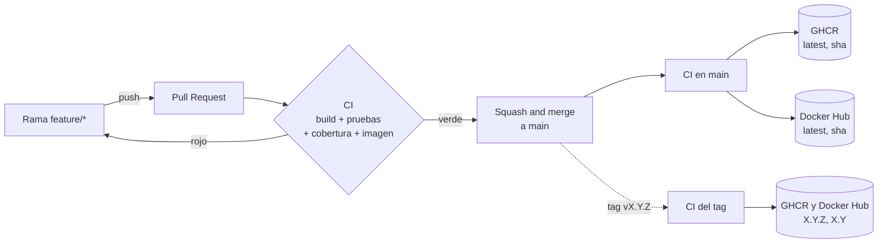

# Guía de CI/CD de contract-api

Guía práctica para trabajar con el flujo de integración y entrega continua del proyecto: cómo se integra un cambio en `main`, qué valida el pipeline, dónde se publica la imagen Docker y cómo ejecutarla. Las decisiones y sus motivos están en [ADR-0009](../adr/0009-ci-cd-github-actions.md) (GitHub Actions) y [ADR-0010](../adr/0010-jenkins-local-de-practica.md) (Jenkins local).

## Índice

1. [Visión general](#1-visión-general)
2. [Requisitos](#2-requisitos)
3. [Flujo de trabajo con GitHub Flow](#3-flujo-de-trabajo-con-github-flow)
4. [Protección de `main` (ruleset)](#4-protección-de-main-ruleset)
5. [El pipeline de GitHub Actions](#5-el-pipeline-de-github-actions)
6. [Publicar una versión](#6-publicar-una-versión)
7. [Registros de imágenes: GHCR y Docker Hub](#7-registros-de-imágenes-ghcr-y-docker-hub)
8. [Ejecutar la imagen publicada](#8-ejecutar-la-imagen-publicada)
9. [Manejo de secretos](#9-manejo-de-secretos)
10. [Jenkins local](#10-jenkins-local)
11. [Problemas frecuentes](#11-problemas-frecuentes)

## 1. Visión general



| Evento | Build y pruebas | Imagen | Publicación |
|---|:-:|:-:|---|
| Pull Request a `main` | ✅ | se construye | ninguna |
| Push a `main` (merge) | ✅ | se construye | `latest` y sha corto |
| Tag `vX.Y.Z` | ✅ | se construye | `X.Y.Z` y `X.Y` |
| Manual (*Run workflow*) | ✅ | se construye | según la rama elegida |

## 2. Requisitos

- Git y una cuenta de GitHub con acceso al repositorio.
- Docker Desktop (contenedores Linux) para ejecutar la imagen, las pruebas con Testcontainers y Jenkins.
- JDK 21 solo si compilas en local (`./mvnw` descarga Maven).
- Git Bash o PowerShell. Los comandos indican en cuál se ejecutan cuando la sintaxis difiere.

## 3. Flujo de trabajo con GitHub Flow

`main` siempre es desplegable y **nunca recibe commits directos**. Todo cambio entra por Pull Request.

### 3.1 Crear la rama

```bash
git checkout main
git pull
git checkout -b feature/mi-cambio        # o fix/<tema>, docs/<tema>
```

### 3.2 Trabajar y verificar en local

```bash
./mvnw clean verify      # lo mismo que ejecuta el CI, incluido el umbral de cobertura
```

Los mensajes de commit van en español, en imperativo y explican el porqué:

```bash
git add <archivos>
git commit -m "Validar el formato del correo al registrar empleados"
git push -u origin feature/mi-cambio
```

### 3.3 Abrir el Pull Request

1. GitHub muestra **Compare & pull request** tras el push; o entra a *Pull requests → New pull request*.
2. Completa la plantilla: en **Qué cambia** describe el cambio y su motivo; marca la checklist.
3. Espera los dos checks: **Build, pruebas y cobertura** e **Imagen Docker**.

### 3.4 Integrar

- Si GitHub indica **This branch is out-of-date with the base branch**, pulsa **Update branch** y espera de nuevo el CI.
- Con los checks en verde: **Squash and merge** → **Confirm**. Es el único método permitido: cada PR queda como un solo commit en `main`.
- Borra la rama (botón **Delete branch**) y actualiza tu copia local:

```bash
git checkout main
git pull
git branch -D feature/mi-cambio      # -D porque con squash git no reconoce la rama como integrada
```

## 4. Protección de `main` (ruleset)

La regla `main-protegida` está versionada en [`.github/ruleset/main-protegida.json`](../../.github/ruleset/main-protegida.json):

| Regla | Efecto |
|---|---|
| Pull Request obligatorio | No se puede hacer push directo a `main`. Sin aprobaciones mínimas (un único desarrollador no puede aprobar su propio PR). |
| Solo *squash* | Un commit por PR en `main`. |
| Checks requeridos | `Build, pruebas y cobertura` e `Imagen Docker` deben estar en verde. |
| Rama al día | La rama debe incluir los últimos cambios de `main` antes de integrarse. |
| Sin force push ni borrado | Protege el historial de `main`. |

**Configurarla en un repositorio nuevo o en tu fork:** *Settings → Rules → Rulesets → New ruleset → Import a ruleset* y selecciona el JSON. Los checks requeridos solo aparecen en el buscador después de que el workflow se haya ejecutado una vez.

> En un repositorio **privado** con plan Free, GitHub permite crear la regla pero **no la aplica** (aparece con un ícono amarillo). Hace falta que el repositorio sea público o un plan Pro/Team. Con la regla activa el ícono es verde.

Si cambias el JSON, hay que volver a importarlo a mano en GitHub: el archivo es la referencia, no se aplica solo.

## 5. El pipeline de GitHub Actions

Definido en [`.github/workflows/ci-cd.yml`](../../.github/workflows/ci-cd.yml). Tiene dos jobs; el segundo solo empieza si el primero termina bien.

### 5.1 Job `Build, pruebas y cobertura`

- Ejecuta `./mvnw -B -ntp clean verify` con JDK 21 (Temurin) y caché de Maven.
- Incluye las pruebas de integración con **Testcontainers** (PostgreSQL real; el runner `ubuntu-latest` ya tiene Docker).
- **JaCoCo** exige al menos un **80 % de líneas cubiertas** en `domain` y `application`; si no se alcanza, el build falla. `infrastructure` solo genera el informe.
- Al terminar, aunque falle:
  - escribe una tabla de cobertura por módulo en el **resumen** de la ejecución (*Actions → ejecución → Summary*);
  - publica el artefacto **reports** (informes de Surefire y JaCoCo, 14 días). Descárgalo desde la ejecución y abre `*/target/site/jacoco/index.html`.

### 5.2 Job `Imagen Docker`

- Construye la imagen con el [`Dockerfile`](../../Dockerfile) multi-stage: compila con el Maven Wrapper (sin pruebas, ya se ejecutaron), extrae las capas de Spring Boot y genera una imagen con JRE 21, usuario sin privilegios y perfil `prod`.
- En un PR solo la construye (comprueba que el `Dockerfile` funciona). En `main` y en tags, además la publica (sección 7).
- Usa la caché de GitHub Actions para las capas, así que las ejecuciones siguientes son más rápidas.

### 5.3 Ejecutar el pipeline a mano

*Actions → CI/CD → Run workflow* y elige la rama. Útil, por ejemplo, después de configurar un secreto sin tener que hacer un commit.

## 6. Publicar una versión

Las versiones siguen [SemVer](https://semver.org/lang/es/) y se crean con un tag sobre `main`:

```bash
git checkout main
git pull
git tag v0.2.0
git push origin v0.2.0
```

El pipeline publica la imagen con las etiquetas `0.2.0` y `0.2`. `latest` no cambia con un tag: solo avanza con los merges a `main`.

Opcional: *Releases → Draft a new release*, elige el tag, pulsa **Generate release notes** y **Publish release**.

## 7. Registros de imágenes: GHCR y Docker Hub

La misma imagen y las mismas etiquetas se publican en dos registros:

| | GHCR | Docker Hub |
|---|---|---|
| Imagen | `ghcr.io/galaxytraining/curs-000617-cicd` | `docker.io/anovoa1975/curs-000617-cicd` |
| Visibilidad | Privada (la organización no permite paquetes públicos) | Pública |
| Para descargar | `docker login ghcr.io` con un token | Sin login |
| Credenciales en el pipeline | `GITHUB_TOKEN`, automático | Variable `DOCKERHUB_USERNAME` y secreto `DOCKERHUB_TOKEN` |

### 7.1 Descargar desde Docker Hub (recomendado)

```bash
docker pull anovoa1975/curs-000617-cicd:latest
docker pull anovoa1975/curs-000617-cicd:0.1.0
```

Docker Hub limita las descargas anónimas por IP. Si un aula entera comparte IP y alcanza el límite, inicia sesión con `docker login` (cuenta gratuita) para tener un límite mayor.

### 7.2 Descargar desde GHCR

1. Crea un token **classic** (empieza por `ghp_`) con solo el permiso `read:packages`: <https://github.com/settings/tokens/new?scopes=read:packages&description=ghcr-read>. Los tokens *fine-grained* no sirven para GHCR.
2. Si aparece **Configure SSO** junto al token, autorízalo para `GalaxyTraining`.
3. Inicia sesión **sin escribir el token en el comando** (PowerShell):

```powershell
$t = Read-Host "Token"                     # pega el token cuando aparezca "Token:"
$t | docker login ghcr.io -u <tu-usuario-github> --password-stdin
Remove-Variable t
```

4. `docker pull ghcr.io/galaxytraining/curs-000617-cicd:latest`

### 7.3 Configurar Docker Hub en tu propio repositorio o fork

Sin esta configuración el pipeline publica solo en GHCR y no falla.

1. En Docker Hub: crea el repositorio `curs-000617-cicd` como **Public** y un token en *Account settings → Personal access tokens* con permiso **Read & Write**.
2. En GitHub: *Settings → Secrets and variables → Actions*:
   - pestaña **Variables** → *New repository variable*: `DOCKERHUB_USERNAME` = tu usuario de Docker Hub;
   - pestaña **Secrets** → *New repository secret*: `DOCKERHUB_TOKEN` = el token.
3. Ejecuta el pipeline (*Run workflow* sobre `main`) y comprueba que el paso **Login en Docker Hub** está en verde, no *skipped*.

> El usuario va como **variable** y no como secreto a propósito: forma parte del nombre de la imagen, y los secretos se enmascaran como `***` en los logs.

## 8. Ejecutar la imagen publicada

La imagen arranca con el perfil `prod`: **no tiene valores por defecto ni genera claves**. Necesita la base de datos y un par de claves RSA para firmar los JWT; si falta algo, no arranca. Swagger está desactivado.

### 8.1 Base de datos

Usa el PostgreSQL del proyecto:

```bash
docker compose up -d        # desde la raíz del repositorio: PostgreSQL (5432) y pgAdmin (5050)
```

### 8.2 Generar las claves y el archivo de variables (Git Bash)

Créalos **fuera del repositorio**:

```bash
mkdir -p ~/contract-api-prod && cd ~/contract-api-prod

openssl genpkey -algorithm RSA -pkeyopt rsa_keygen_bits:2048 -out private.pem
openssl pkey -in private.pem -pubout -out public.pem

# Cada PEM en una sola línea con \n literales (la API los admite así)
PUB=$(awk '{printf "%s\\n", $0}' public.pem)
PRIV=$(awk '{printf "%s\\n", $0}' private.pem)

cat > prod.env <<EOF
DB_URL=jdbc:postgresql://host.docker.internal:5432/contracts
DB_USERNAME=contract
DB_PASSWORD=contract
SECURITY_JWT_PUBLIC_KEY=$PUB
SECURITY_JWT_PRIVATE_KEY=$PRIV
SECURITY_BOOTSTRAP_ADMIN_USERNAME=admin
SECURITY_BOOTSTRAP_ADMIN_PASSWORD=<elige-una-contraseña-de-12-o-más>
EOF
```

- `host.docker.internal` permite al contenedor llegar al PostgreSQL publicado en tu máquina.
- La contraseña del administrador debe tener entre 12 y 64 caracteres (BR-USR-003).
- El administrador inicial solo se crea si **no existe ningún usuario `ADMIN`** en la base (BR-USR-007). Si ya probaste la API en local con esa base, usa las credenciales que creaste entonces.

### 8.3 Ejecutar el contenedor

Git Bash:

```bash
docker run -d --name contract-api-prod -p 8081:8081 \
  --env-file ~/contract-api-prod/prod.env \
  anovoa1975/curs-000617-cicd:latest

docker logs -f contract-api-prod      # espera "Started ContractApiApplication"; sal con Ctrl+C
```

PowerShell (la continuación de línea es el acento grave y `~` no se expande para programas externos):

```powershell
docker run -d --name contract-api-prod -p 8081:8081 `
  --env-file "$HOME\contract-api-prod\prod.env" `
  anovoa1975/curs-000617-cicd:latest
```

Si el puerto 8081 está ocupado (por ejemplo, por la API en `spring-boot:run`), usa `-p 8082:8081` y llama al 8082.

### 8.4 Probar la API (PowerShell)

```powershell
$pwd = Read-Host "Contraseña de admin" -AsSecureString
$plain = [Net.NetworkCredential]::new('', $pwd).Password
$body = @{ username = 'admin'; password = $plain } | ConvertTo-Json

$login = Invoke-RestMethod -Method Post -Uri http://localhost:8081/api/v1/auth/login `
  -ContentType 'application/json' -Body $body
$h = @{ Authorization = "Bearer $($login.accessToken)" }

Invoke-RestMethod http://localhost:8081/api/v1/auth/me -Headers $h            # usuario actual
Invoke-RestMethod http://localhost:8081/actuator/health -Headers $h           # status UP (requiere system:monitor)
Invoke-RestMethod "http://localhost:8081/api/v1/employees?page=0&size=5" -Headers $h
```

Un `401` con código `AUTH-002` en el login significa usuario o contraseña incorrectos.

### 8.5 Limpiar

```bash
docker rm -f contract-api-prod
```

## 9. Manejo de secretos

`private.pem` firma todos los tokens de acceso: quien la tenga puede emitir tokens válidos.

**Nunca:**

- versionar claves, `.env` ni tokens: `.gitignore` y `.dockerignore` ya ignoran `*.pem`, `*.key` y `*.env` como red de seguridad;
- escribir un token dentro de un comando o pegarlo en un chat, captura o ticket: queda en el historial de la terminal y en el destino. Si ocurre, **revócalo y crea otro**;
- reutilizar las contraseñas por defecto del entorno local (`contract`, `admin`) en un servidor.

**Variables de entorno frente a archivos.** Con `--env-file`, las claves quedan como variables de entorno y cualquiera con acceso a Docker las ve con `docker inspect <contenedor>`. Es más seguro montarlas como archivos con `secrets` de Docker Compose y que Spring Boot las lea con `configtree` (cada archivo de la carpeta se convierte en la propiedad de su nombre). No requiere cambios en el código:

```yaml
# ~/contract-api-prod/docker-compose.yml
services:
  api:
    image: anovoa1975/curs-000617-cicd:latest
    ports: ["8081:8081"]
    environment:
      SPRING_CONFIG_IMPORT: "optional:configtree:/run/secrets/"
      DB_URL: jdbc:postgresql://host.docker.internal:5432/contracts
      DB_USERNAME: contract
    secrets:
      - source: jwt_private
        target: security.jwt.private-key
      - source: jwt_public
        target: security.jwt.public-key
      - source: db_password
        target: spring.datasource.password
secrets:
  jwt_private: { file: ./private.pem }
  jwt_public:  { file: ./public.pem }
  db_password: { file: ./db_password.txt }
```

`db_password.txt` contiene solo la contraseña, sin salto de línea final (PowerShell: `Set-Content -NoNewline -Encoding ascii db_password.txt contract`). Los PEM van tal cual, con sus saltos de línea. Se levanta con `docker compose up -d` desde esa carpeta.

**En un servidor real** las claves viven en un gestor de secretos (Kubernetes Secrets, AWS Secrets Manager, Azure Key Vault, *Environment secrets* de GitHub) y la plataforma las inyecta al desplegar; nunca en la imagen ni junto al código.

**Rotación:** genera un par nuevo, actualiza el secreto, usa un `SECURITY_JWT_KEY_ID` nuevo (p. ej. `contract-api-2`) y reinicia. Los access tokens emitidos con la clave anterior dejan de valer (duran como máximo 15 minutos); los refresh tokens no se ven afectados porque son opacos y están en la base de datos.

## 10. Jenkins local

Para practicar con Jenkins hay un entorno listo en [`docker/jenkins/`](../../docker/jenkins/README.md) que ejecuta el [`Jenkinsfile`](../../Jenkinsfile) del repositorio: mismas etapas que el CI (`./mvnw clean verify` e imagen Docker), sin publicar.

```bash
docker compose -f docker/jenkins/docker-compose.yml up -d --build
```

Abre <http://localhost:8080>, entra con `admin` / `admin` y ejecuta el job **contract-api** con **Build Now**. La primera ejecución tarda unos minutos porque descarga dependencias e imágenes. Los detalles (variables, fork, limpieza) están en su [README](../../docker/jenkins/README.md).

Jenkins es solo de práctica: el check que protege `main` es el de GitHub Actions ([ADR-0010](../adr/0010-jenkins-local-de-practica.md)).

## 11. Problemas frecuentes

| Síntoma | Causa | Solución |
|---|---|---|
| El ruleset aparece con ícono amarillo | Repositorio privado con plan Free | Hacer público el repositorio o usar un plan Pro/Team (sección 4) |
| *This branch is out-of-date with the base branch* | `main` avanzó después de abrir el PR | **Update branch** y esperar el CI |
| *Squash and merge* deshabilitado | Checks pendientes o en rojo, o rama desactualizada | Revisar el job fallido en *Checks*; actualizar la rama |
| El build falla por cobertura | `domain` o `application` por debajo del 80 % de líneas | Añadir pruebas; ver el informe en el artefacto **reports** |
| `Login en Docker Hub` aparece *skipped* | El workflow no ve la variable `DOCKERHUB_USERNAME` (se creó como secreto o en un *Environment*) | Crearla en la pestaña **Variables** del repositorio y ejecutar *Run workflow* |
| `Login en Docker Hub` falla con `unauthorized` | Token sin permiso *Write*, vencido o de otra cuenta | Generar un token **Read & Write** de la cuenta correcta y actualizar `DOCKERHUB_TOKEN` |
| `denied` al hacer `docker login ghcr.io` | Token vacío (no se ve al pegar), *fine-grained*, sin `read:packages` o sin autorización SSO | Usar `--password-stdin` (sección 7.2) y revisar el token |
| *Public: Setting is disabled by organization administrators* | La organización no permite paquetes públicos en GHCR | Usar Docker Hub o `docker login ghcr.io` |
| El contenedor termina al arrancar con *JWT keys are not configured* | Faltan `SECURITY_JWT_PUBLIC_KEY` / `SECURITY_JWT_PRIVATE_KEY` | Revisar `prod.env` (sección 8.2) |
| El contenedor no conecta a la base de datos | PostgreSQL no está levantado o `DB_URL` usa `localhost` | `docker compose up -d` y usar `host.docker.internal` |
| *An ADMIN user already exists; initial administrator not created.* | La base ya tenía un administrador | Es lo esperado: usa sus credenciales |
| `port is already allocated` | Otro proceso usa el puerto (8080 Jenkins, 8081 la API) | Detenerlo o publicar en otro puerto (`-p 8082:8081`) |
| `docker build` falla en Jenkins con `--mount` | Falta BuildKit (`buildx`) | La imagen de `docker/jenkins` ya lo incluye; reconstruirla con `--build` |
